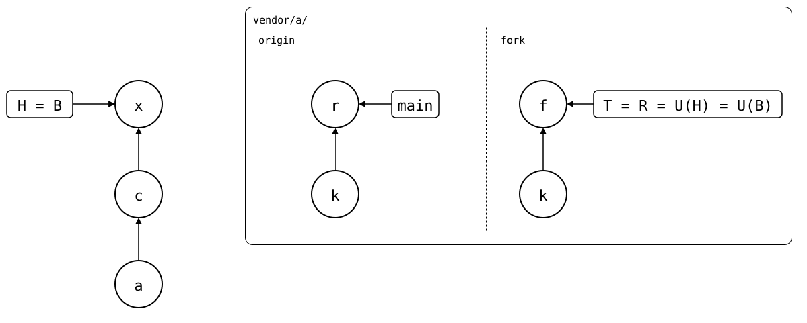

# Scenario: original-without-the-patch

The [same splice](../README.md), right before it takes a release of the
original: the monorepo pulled the fork's patch, and the original moved
on without it. The original's `main` lacks the synced commit, as a
[rebased patch branch](../../../06-rewritten-history/04-patch-branch-rebased/README.md)
does, but nothing was rewritten: the original never had the patch.

<div align="center">



</div>

`git splice pull --upstream origin` merges *r* in. Git's merge base of
R, *f*, and *r* is *k*, so the fork's patch is a change on the
monorepo's side only, and stays. A rebased branch would merge from its
fork point instead, where the fetched branch was before, but the
original's fetched `main` never pointed at *f*: its reflog has only *k*
and *r*. What the fork has doesn't matter for a pull from the original.

## Output

<!--
```scrut {fail_fast: true, output_stream: combined}
$ source "$TESTDIR/../../../readme-setup.sh" && export GIT_CONFIG_COUNT=2 GIT_CONFIG_KEY_0="url.$UPSTREAM.insteadOf" GIT_CONFIG_VALUE_0=https://git.example.com/lib.git GIT_CONFIG_KEY_1="url.$UPSTREAM-fork.git.insteadOf" GIT_CONFIG_VALUE_1=https://git.example.com/company/lib.git
```
-->

[`setup.bash`](setup.bash) builds this state:

```scrut
$ build_scenario scenario_original_without_the_patch https://git.example.com/lib.git https://git.example.com/company/lib.git
```

<!--
```scrut
$ check_drawing "$TESTDIR/original-without-the-patch.drawio.svg" \
>   a=HEAD~2 c=HEAD~1 x=HEAD k=refs/splices/lib/heads/main~1 \
>   r=refs/splices/lib/heads/main f=refs/splices/company-lib/heads/main
ok   original-without-the-patch.drawio.svg: 7 commits, 7 arrows, 3 boxes, 1 lanes, 2 upstreams
```
-->

The original's fetched `main` was *k*, then *r*:

```scrut
$ git log -g --format=%s refs/splices/lib/heads/main
original release
seed
```

```scrut
$ git splice pull --upstream origin vendor/a
ok   vendor/a fetched from origin
ok   vendor/a: pulled 3fd09f0
```

The folder has both the patch and the release:

```scrut
$ cat vendor/a/file.txt vendor/a/release.txt
seed
fork patch
original release
```
