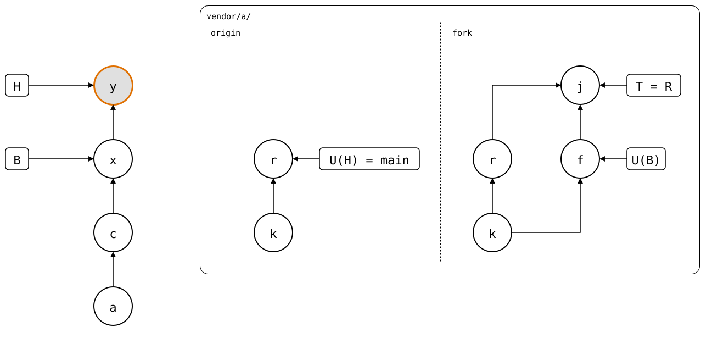

# Scenario: several-upstreams

A library with two upstreams: the third-party original, and the
company's fork of it, which carries a patch of its own. The monorepo
works with the fork, and takes the original's releases through it
([#107](https://github.com/roschaefer/git-splice/issues/107)).

- **Original** (`$UPSTREAM`, reached as `https://git.example.com/lib.git`):
  `seed`.
- **Fork** (`$UPSTREAM-fork.git`, reached as
  `https://git.example.com/company/lib.git`): a copy of the original,
  then `fork patch`.
- **Monorepo**: `vendor/a/`, cloned from the original at `seed`.

## Output

<!--
```scrut {fail_fast: true, output_stream: combined}
$ source "$TESTDIR/../../readme-setup.sh" && export GIT_CONFIG_COUNT=2 GIT_CONFIG_KEY_0="url.$UPSTREAM.insteadOf" GIT_CONFIG_VALUE_0=https://git.example.com/lib.git GIT_CONFIG_KEY_1="url.$UPSTREAM-fork.git.insteadOf" GIT_CONFIG_VALUE_1=https://git.example.com/company/lib.git
```
-->

[`setup.bash`](setup.bash) builds this state:

```scrut
$ build_scenario scenario_several_upstreams https://git.example.com/lib.git
```

### Adding the fork

A `.splice` names its upstreams like Git names remotes. The fork is one
more `[upstream]` section, and since the splice now has two,
`default-upstream` says which one commands use unless `--upstream` names
another:

```scrut
$ git config --file vendor/a/.splice upstream.fork.url https://git.example.com/company/lib.git
```

```scrut
$ git config --file vendor/a/.splice splice.default-upstream fork
```

```scrut
$ git commit -q -m "vendor/a: work with the company fork" -- vendor/a/.splice
```

```scrut
$ cat vendor/a/.splice | tr '\t' ' '
[splice]
 commit = bde416459fbcc09c9b585f3b65a94cab3f68bfcd
 id = c7ecd5a4c78d8a27
 default-upstream = fork
[upstream "origin"]
 url = https://git.example.com/lib.git
[upstream "fork"]
 url = https://git.example.com/company/lib.git
```

The synced commit stays one per splice: a sync point is a commit,
whichever upstream it came from. A fork shares the original's history,
so either can continue from it.

### Fetching both

`fetch` fetches every upstream of the splice, each under its own key:

```scrut
$ git splice fetch
ok   vendor/a fetched from origin
ok   vendor/a fetched from fork
```

```scrut
$ git config --get-regexp '^splice\.'
splice.lib.url https://git.example.com/lib.git
splice.company-lib.url https://git.example.com/company/lib.git
```

A splice with several upstreams names its upstream branch as
`<name>/<branch>`, like `origin/main` in Git. The default one is the
fork, which has the patch:

```scrut
$ git splice status
On branch main

  behind 1  vendor/a -> fork/main
```

`--upstream` compares with the original instead:

```scrut
$ git splice status --upstream origin
On branch main

  up to date  vendor/a -> origin/main
```

```scrut
$ git splice pull vendor/a
ok   vendor/a fetched from fork
ok   vendor/a: pulled 9bf41c7
```

Now the folder has the fork's patch, which the original lacks. A push to
the original would contribute it:

```scrut
$ git splice status --upstream origin
On branch main

  ahead 1  vendor/a -> origin/main
```

### Taking a release of the original

The original moves on:

```scrut
$ seed_bare_repo "$UPSTREAM" "original release" main release.txt
```

```scrut
$ git splice fetch --upstream origin
ok   vendor/a fetched from origin (main moved bde4164..3fd09f0)
```

```scrut
$ git splice status --upstream origin
On branch main

  ahead 1, behind 1  vendor/a -> origin/main
```

```scrut
$ git splice pull --upstream origin vendor/a
ok   vendor/a fetched from origin
ok   vendor/a: pulled 3fd09f0
```

The pull joins the release with the fork's patch, as `git pull` would.
The fork lacks the release and the join, so a plain push sends them to
the fork:

```scrut
$ git splice status
On branch main

  ahead 2  vendor/a -> fork/main
```

```scrut
$ git splice push vendor/a
ok   vendor/a: pushed 3a54571 to fork/main
```

```scrut
$ git -C "$UPSTREAM-fork.git" log --graph --format=%s main
*   splice: pull vendor/a from origin/main at 3fd09f0
|\  
| * original release
* | fork patch
|/  
* seed
```

```scrut
$ git splice status
On branch main

  up to date  vendor/a -> fork/main
```

### Both upstreams afterwards

The monorepo has *x*, which pulled the fork's patch *f*, and *y*, which
joined the original's release *r* with it. The push sent *j*, the
rebuild of *y*, to the fork. Both upstreams have *k* and *r*, so the
drawing shows them on each side of the dashed line. Only the fork has
*f* and *j*:

<div align="center">



</div>

<!--
```scrut
$ check_drawing "$TESTDIR/several-upstreams.drawio.svg" \
>   a=HEAD~3 c=HEAD~2 x=HEAD~1 y=HEAD k=refs/splices/lib/main~1 \
>   r=refs/splices/lib/main f=refs/splices/company-lib/main^1 \
>   j=refs/splices/company-lib/main
ok   several-upstreams.drawio.svg: 10 commits, 13 arrows, 5 boxes, 1 lanes, 2 upstreams
```
-->
