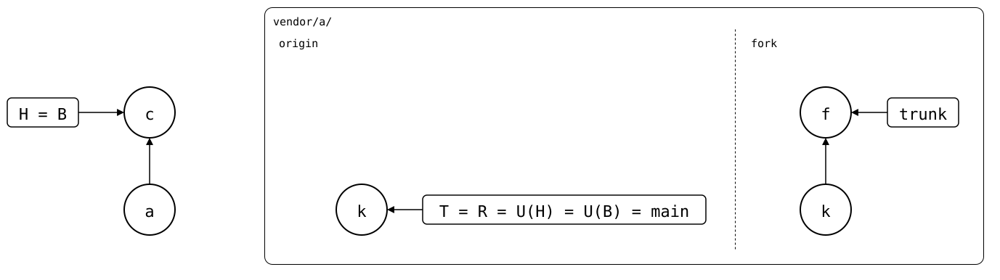

# A fork with its own default branch

The company fork names its default branch `trunk`, the original `main`
([#122](https://github.com/roschaefer/git-splice/issues/122)). Each
upstream in `.splice` can record its own `default-branch`, so on the
monorepo's `main`, each syncs with its own default branch.

[`setup.bash`](setup.bash) builds the state of
[several-upstreams](README.md): `vendor/a/` from the original, and its
company fork.

## Output

<!--
```scrut {fail_fast: true, output_stream: combined}
$ source "$TESTDIR/../../readme-setup.sh" && export GIT_CONFIG_COUNT=2 GIT_CONFIG_KEY_0="url.$UPSTREAM.insteadOf" GIT_CONFIG_VALUE_0=https://git.example.com/lib.git GIT_CONFIG_KEY_1="url.$UPSTREAM-fork.git.insteadOf" GIT_CONFIG_VALUE_1=https://git.example.com/company/lib.git
```
-->

```scrut
$ build_scenario scenario_several_upstreams https://git.example.com/lib.git
```

The fork renames its default branch:

```scrut
$ git -C "$UPSTREAM-fork.git" branch -m main trunk
```

### Each upstream's default branch

The fork is added with its default branch, and the original stays the
default upstream:

```scrut
$ git config --file vendor/a/.splice upstream.fork.url https://git.example.com/company/lib.git &&
>   git config --file vendor/a/.splice upstream.fork.default-branch trunk &&
>   git config --file vendor/a/.splice splice.default-upstream origin &&
>   git commit -q -m "vendor/a: add the company fork" -- vendor/a/.splice
```

```scrut
$ git config --file vendor/a/.splice --list
splice.commit=[0-9a-f]{40} (regex)
splice.id=[0-9a-f]{16} (regex)
splice.default-upstream=origin
upstream.origin.url=https://git.example.com/lib.git
upstream.fork.url=https://git.example.com/company/lib.git
upstream.fork.default-branch=trunk
```

On `main`, the original syncs with its `main`, the fork with `trunk`:

```scrut
$ git splice fetch >/dev/null && git splice status
On branch main

  up to date  vendor/a -> origin/main
```

```scrut
$ git splice status --upstream fork
On branch main

  behind 1  vendor/a -> fork/trunk
```

*c* (`vendor/a: add the company fork`) named the fork on `trunk`. The
original's `main` is still *k* (`seed`), where the monorepo cloned it in
*a* (`add vendor/a`); the fork's `trunk` has *f* (`fork patch`) on top:

<div align="center">



</div>

<!--
```scrut
$ check_drawing "$TESTDIR/fork-default-branch.drawio.svg" \
>   a=HEAD~1 c=HEAD k=refs/splices/lib/main f=refs/splices/company-lib/trunk
ok   fork-default-branch.drawio.svg: 5 commits, 5 arrows, 3 boxes, 1 lanes, 2 upstreams
```
-->

### The earlier format

A `default-branch` in `[splice]` named one branch for every upstream.
It's refused, rather than read for the default upstream only:

```scrut
$ git config --file vendor/a/.splice splice.default-branch master &&
>   git commit -q -m "the earlier format" -- vendor/a/.splice &&
>   git splice status
!!   vendor/a/.splice has default-branch in [splice], from an earlier version -- it belongs to an upstream now: upstream.<name>.default-branch
[1]
```
