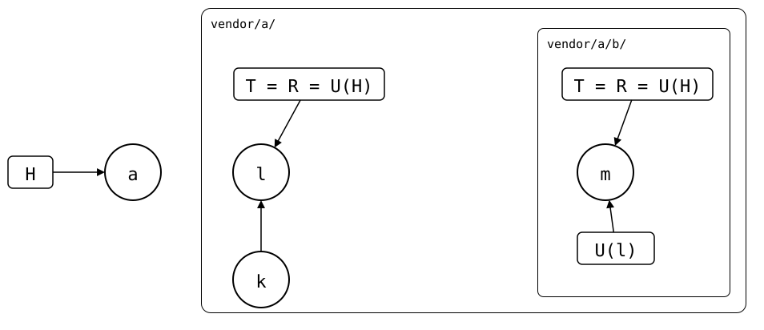

# Scenario: nested-splices

One splice below another: the outer splice `vendor/a/` and the inner
splice `vendor/a/b/`. The outer upstream uses `git-splice` itself: it has
the inner upstream spliced in at `b/`, with a `b/.splice` of its own.
Cloning the outer upstream into the monorepo brings that `.splice` along,
so `vendor/a/b/` is a splice in the monorepo too.

- **Inner upstream** (`$UPSTREAM-b.git`, reached as
  `https://git.example.com/b.git`): *m* (`b seed`).
- **Outer upstream** (`$UPSTREAM`): *k* (`a seed`), then *l* (`add b`),
  which spliced the inner upstream in at `b/`.
- **Monorepo**: *a* (`add vendor/a`) cloned *l* into `vendor/a/`, and with it
  `vendor/a/b/`, from the inner upstream. Both are fetched.

Each push sends its folder without its own `.splice`. So the push of
`vendor/a/` sends `vendor/a/b/.splice` with the inner splice's files, and
in the outer upstream, `b/` stays a splice that `git-splice` can pull and
push there.
[The design](../../../../docs/design/README.md#refs-instead-of-remotes)
explains why both repositories agree on the inner splice's state.

<div align="center">



</div>

Each splice has a lane, labelled with its folder, and the lanes nest
as the folders do. *l*'s `b/.splice` records *m*: U(l) = *m*, the same commit
as the monorepo's U(H) for `vendor/a/b/`.

## Output

<!--
```scrut {fail_fast: true, output_stream: combined}
$ source "$TESTDIR/../../readme-setup.sh" && export GIT_CONFIG_COUNT=1 GIT_CONFIG_KEY_0="url.$UPSTREAM-b.git.insteadOf" GIT_CONFIG_VALUE_0=https://git.example.com/b.git
```
-->

[`setup.bash`](setup.bash) builds this state:

```scrut
$ build_scenario scenario_nested_splices https://git.example.com/b.git
```

The drawing shows what Git and `git-splice` say about it, with each
commit named by its place in the history
([`check_drawing`](../../../../check-drawing/)):

```scrut
$ check_drawing "$TESTDIR/nested-splices.drawio.svg" \
>   a=HEAD k=refs/splices/upstream/main~1 l=refs/splices/upstream/main \
>   m=refs/splices/b/main
ok   nested-splices.drawio.svg: 4 commits, 5 arrows, 4 boxes, 2 lanes
```

Both splices are up to date:

```scrut
$ git splice status
On branch main

  up to date  vendor/a
  up to date  vendor/a/b
```

A change in `vendor/a/b/` is a change in `vendor/a/` too:

```scrut
$ echo "b local" >>vendor/a/b/file.txt && git commit -q -a -m "b local"
```

```scrut
$ git splice status
On branch main

  ahead 1  vendor/a
  ahead 1  vendor/a/b
```

Each push sends its own folder, bottom-up: the inner upstream gets the change,
without `.splice`:

```scrut
$ git splice push vendor/a/b vendor/a
ok   vendor/a/b: pushed 701ab17 to main
ok   vendor/a: pushed b42292d to main
```

```scrut
$ git -C "$UPSTREAM-b.git" ls-tree -r --name-only main
file.txt
```

The outer upstream gets it too, with `b/.splice`:

```scrut
$ git -C "$UPSTREAM" ls-tree -r --name-only main
b/.splice
b/file.txt
file.txt
```

## The outer upstream pulls the inner one

Someone working in the outer upstream pulls the inner upstream's new
commit there, and pushes the result. (`seed_bare_repo`, from
[`fixtures.bash`](../../../helpers/fixtures.bash), commits a line to a file
of the inner upstream.)

```scrut
$ seed_bare_repo "$UPSTREAM-b.git" "b upstream change" main other.txt
```

```scrut
$ git clone -q "$UPSTREAM" ../a-work &&
>   git -C ../a-work -c user.name=Test -c user.email=test@example.com splice pull b &&
>   git -C ../a-work push -q origin main
ok   b fetched
ok   b: pulled 527b1a2
```

Meanwhile, the monorepo has a new commit in `vendor/a/b/`:

```scrut
$ echo "b local 2" >>vendor/a/b/file.txt && git commit -q -a -m "b local 2"
```

Pulling `vendor/a/` brings in `b/.splice` as the outer upstream has it,
with a newer synced commit. `pull` fetches the splices below `vendor/a/`
too, so that commit is there:

```scrut
$ git splice pull vendor/a
ok   vendor/a fetched (main moved b42292d..1ca3147)
ok   vendor/a/b fetched (main moved 701ab17..527b1a2)
ok   vendor/a: pulled 1ca3147
```

The pull records the inner splice's new synced commit. Its unpushed
commit is kept, and the next push joins it with the change in the inner
upstream:

```scrut
$ git splice status
On branch main

  ahead 2  vendor/a
  ahead 2  vendor/a/b
```

```scrut
$ git splice push vendor/a/b
ok   vendor/a/b: pushed c5dc450 to main
```

```scrut
$ git -C "$UPSTREAM-b.git" log --graph --format=%s main
*   splice: pull vendor/a from main at 1ca3147
|\  
| * b upstream change
* | b local 2
|/  
* b local
* b seed
```

If the monorepo had pulled `vendor/a/b/` as well, to a different commit,
the pull of `vendor/a/` would have conflicted: see
[Limits](../../../../docs/design/README.md#limits).

Once the monorepo has pushed a change in `vendor/a/b/`, another monorepo
that splices the outer upstream in rebuilds the inner splice's history up
to the clone from the outer upstream, so the inner splice's first change
there goes on top of the pushed one:
[spliced into another monorepo](spliced-elsewhere.md). That history comes
from the splice above with the newest last pull, even two levels up
([three levels](02-three-levels/README.md)); not where the outer upstream has
another splice at `b/` ([replaced above](replaced-above.md)); and it
doesn't drop what the inner upstream got from the monorepo directly
([pushed and made above](pushed-and-made-above.md)).

A pull of `vendor/a/` can move `vendor/a/b/` to a synced commit the inner
upstream has dropped from its branches; the pull of `vendor/a/b/` then
fetches it by its hash
([dropped below](dropped-below.md)).
