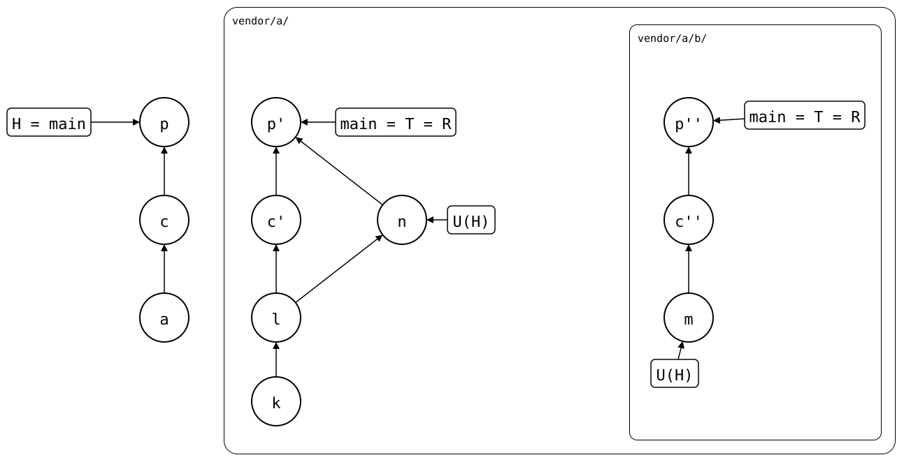

# Scenario: nested-splices, changed above, in a merge

The monorepo changes `vendor/a/b/` and doesn't push it. Meanwhile, a
maintainer changes `b/` in the outer upstream. The monorepo's pull of
`vendor/a/` then merges both, and the rebuild of `vendor/a/`, which
`vendor/a/b/` is [rebuilt from](seen-from-above.md), gets a merge.

A rebuild follows the first parent of each merge only, and turns the
merge into one commit
([why](../../../../docs/design/README.md#splicing-out-push-and-the-rebuild)).
So the rebuild of `vendor/a/b/` gets the maintainer's change in the
pull's commit, under the pull's author: the maintainer's own commit
isn't in it. That's a side effect of the first-parent rule, not a goal,
and a more faithful rebuild could keep the commit some day. A clone of
the outer upstream, after the monorepo pushed both, rebuilds `b/` the
same way, so the inner splice is up to date there: it doesn't matter
where it syncs from.

To keep the commit today, the maintainer pushes `b/` to the inner
upstream before pushing the outer one:
[changed above and pushed below](changed-above-and-pushed-below.md).

## Output

<!--
```scrut {fail_fast: true, output_stream: combined}
$ source "$TESTDIR/../../readme-setup.sh" && export GIT_CONFIG_COUNT=3 GIT_CONFIG_KEY_0="url.$UPSTREAM-b.git.insteadOf" GIT_CONFIG_VALUE_0=https://git.example.com/b.git GIT_CONFIG_KEY_1=user.name GIT_CONFIG_VALUE_1=Test GIT_CONFIG_KEY_2=user.email GIT_CONFIG_VALUE_2=test@example.com
```
-->

[`setup.bash`](setup.bash) builds the state of the [README](README.md):
the outer upstream with the inner one spliced in at `b/`, cloned into
the monorepo:

```scrut
$ build_scenario scenario_nested_splices https://git.example.com/b.git
```

The monorepo changes `vendor/a/b/`, and doesn't push it:

```scrut
$ echo "b local" >vendor/a/b/local.txt &&
>   git add vendor/a/b/local.txt &&
>   git commit -q -m "c: b local"
```

In a clone of the outer upstream, a maintainer changes `b/` too:

```scrut
$ git clone -q "$UPSTREAM" ../a-work &&
>   cd ../a-work &&
>   echo "b in a's upstream" >>b/file.txt &&
>   git -c user.name=Maintainer -c user.email=maintainer@example.com \
>     commit -q -am "n: b in a's upstream" &&
>   git push -q origin HEAD:main &&
>   cd ../monorepo
```

The monorepo pulls `vendor/a/`, which merges both changes:

```scrut
$ git splice pull vendor/a
ok   vendor/a fetched (main moved * (glob)
ok   vendor/a/b fetched
ok   vendor/a: pulled * (glob)
```

<div align="center">


</div>

*c* is the monorepo's change, *n* the maintainer's, and *p* the pull.
Each `'` is one copy by a rebuild. In `vendor/a/`, R is *p'*, the copy
of *p*: a merge of *c'* and *n*. In `vendor/a/b/`, R is *p''*, the copy
of *p'*, with one parent: *n* has no copy there, its change is in
*p''*. Both R are dashed: no upstream branch has them yet, and no local
branch points at them either; `git splice rebuild` computes R when it's
needed. The upstreams' `main` are still at *n* and *m*.

<!--
```scrut
$ check_drawing "$TESTDIR/changed-above-in-a-merge.drawio.svg" \
>   a=HEAD~2 p=HEAD k=refs/splices/upstream/heads/main~2 \
>   l=refs/splices/upstream/heads/main~1 m=refs/splices/b/heads/main
ok   changed-above-in-a-merge.drawio.svg: 11 commits, 14 arrows, 5 boxes, 2 lanes
```
-->

## One change, three paths

*p*, *p'* and *p''* are one change, each at the path its repository has
for `b/`. The monorepo's pull also records the outer upstream's new
commit in `vendor/a/.splice`, which no upstream gets:

```scrut
$ git diff --name-only HEAD^ HEAD
vendor/a/.splice
vendor/a/b/file.txt
```

```scrut
$ git diff --name-only "$(git splice rebuild vendor/a)^" "$(git splice rebuild vendor/a)"
b/file.txt
```

```scrut
$ git diff --name-only "$(git splice rebuild vendor/a/b)^" "$(git splice rebuild vendor/a/b)"
file.txt
```

## The rebuild of `vendor/a/` has the merge

The rebuild of `vendor/a/` has *c'* on one side, the maintainer's *n*
on the other, and the pull that joins them:

```scrut
$ git log --graph --format='%s (%an)' "$(git splice rebuild vendor/a)"
*   splice: pull vendor/a from main at 7d4e7b9 (Test)
|\  
| * n: b in a's upstream (Maintainer)
* | c: b local (Test)
|/  
* add b (Test)
* a seed (Test)
```

## The inner splice has one commit for it

The rebuild of `vendor/a/b/` follows the first parents of the rebuild
of `vendor/a/`, as any rebuild follows the monorepo's. For `vendor/a/b/`,
*p'* is a merge like any other: its second parent *n* is no commit of
the inner upstream, so it's no pull of `vendor/a/b/`. The maintainer's
change comes in with the pull, under its author:

```scrut
$ git log --graph --format='%s (%an)' "$(git splice rebuild vendor/a/b)"
* splice: pull vendor/a from main at 7d4e7b9 (Test)
* c: b local (Test)
* b seed (Test)
```

## The same from a clone of the outer upstream

The monorepo pushes both, bottom-up:

```scrut
$ git splice push vendor/a/b vendor/a
ok   vendor/a/b: pushed * to main (glob)
ok   vendor/a: pushed * to main (glob)
```

Now each upstream's `main` has its R, solid:

<div align="center">



</div>

A push writes nothing to the monorepo, so U(H) still names *n* and *m*.

<!--
```scrut
$ check_drawing "$TESTDIR/changed-above-in-a-merge-pushed.drawio.svg" \
>   a=HEAD~2 p=HEAD k=refs/splices/upstream/heads/main^2~2 \
>   l=refs/splices/upstream/heads/main^2^ m=refs/splices/b/heads/main~2
ok   changed-above-in-a-merge-pushed.drawio.svg: 11 commits, 14 arrows, 5 boxes, 2 lanes
```
-->

In a clone of the outer upstream, `b/` is a splice of its own, and its
rebuild is the commit the inner upstream got from the monorepo:

```scrut
$ git clone -q "$UPSTREAM" ../a-clone &&
>   cd ../a-clone &&
>   git splice fetch b
ok   b fetched
```

```scrut
$ git splice status b
On branch main

  up to date  b
```
