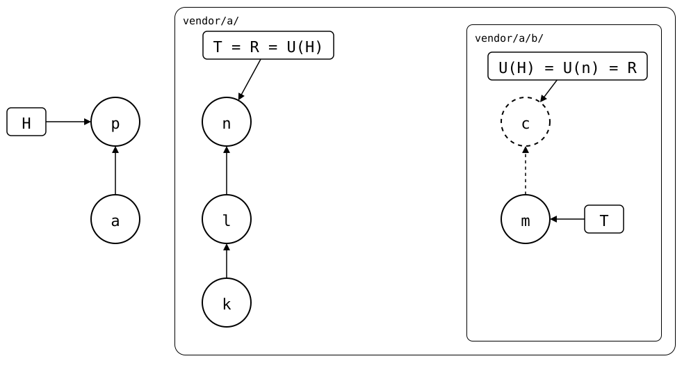

# Scenario: nested-splices, a synced commit the inner upstream dropped

The outer upstream pulls a change of the inner upstream into `b/`, then
the inner upstream drops that change from its `main`, e.g. by a
force-push. The synced commit the outer upstream records for `b/` is on
no branch of the inner upstream any more
([#126](https://github.com/roschaefer/git-splice/issues/126)).

A pull fetches `vendor/a/b/` before it pulls `vendor/a/`, so that fetch
can't ask for the synced commit the pull of `vendor/a/` moves
`vendor/a/b/` to. A pull of `vendor/a/b/` afterwards fetches it by its
hash. Before, `vendor/a/b/` was reported as sharing no history with its
upstream, with advice that included overwriting the upstream's branch.

## Output

<!--
```scrut {fail_fast: true, output_stream: combined}
$ source "$TESTDIR/../../readme-setup.sh" && export GIT_CONFIG_COUNT=3 GIT_CONFIG_KEY_0="url.$UPSTREAM-b.git.insteadOf" GIT_CONFIG_VALUE_0=https://git.example.com/b.git GIT_CONFIG_KEY_1=user.name GIT_CONFIG_VALUE_1=Test GIT_CONFIG_KEY_2=user.email GIT_CONFIG_VALUE_2=test@example.com
```
-->

[`setup.bash`](setup.bash) builds the state of the [README](README.md):
the outer upstream with the inner one spliced in at `b/`, cloned into
the monorepo:

```scrut
$ build_scenario scenario_nested_splices https://git.example.com/b.git
```

## The inner upstream drops a change the outer upstream has

A change in the inner upstream, *c* (`b change`), on top of *m*
(`b seed`):

```scrut
$ seed_bare_repo "$UPSTREAM-b.git" "b change" main other.txt >/dev/null 2>&1
```

In a clone of the outer upstream, `b/` pulls it, and the outer upstream
gets it as *n*, on top of *k* (`a seed`) and *l* (`add b`):

```scrut
$ git clone -q "$UPSTREAM" ../a-work &&
>   cd ../a-work &&
>   git splice pull b &&
>   git push -q origin HEAD:main &&
>   cd ../monorepo
ok   b fetched
ok   b: pulled 95165ad
```

The inner upstream drops *c* again:

```scrut
$ git -C "$UPSTREAM-b.git" update-ref refs/heads/main refs/heads/main^
```

## Pulling both

```scrut
$ git splice pull --all
ok   vendor/a fetched (main moved *..*) (glob)
ok   vendor/a/b fetched
ok   vendor/a: pulled * (glob)
ok   vendor/a/b fetched
ok   vendor/a/b: nothing to pull
```

The pull of `vendor/a/` is *p*, on top of the monorepo's *a*
(`add vendor/a`):

<div align="center">



</div>

*n*'s `b/.splice` records *c*: U(n) = *c*, and so does *p*'s
`vendor/a/b/.splice`, U(H). *c* is dashed: no branch of the inner
upstream has it any more, but the pull fetched it by its hash.

<!--
```scrut
$ check_drawing "$TESTDIR/dropped-below.drawio.svg" \
>   a=HEAD^ p=HEAD k=refs/splices/upstream/main~2 \
>   l=refs/splices/upstream/main~1 n=refs/splices/upstream/main \
>   m=refs/splices/b/main \
>   c="$(git config --file vendor/a/b/.splice splice.commit)"
ok   dropped-below.drawio.svg: 7 commits, 8 arrows, 4 boxes, 2 lanes
```
-->

*c* is in the rebuild of `vendor/a/b/`, R, and the inner upstream lacks
it, so the next push of `vendor/a/b/` brings it back:

```scrut
$ git splice status
On branch main

  ahead 1     vendor/a/b

  up to date  vendor/a
```
