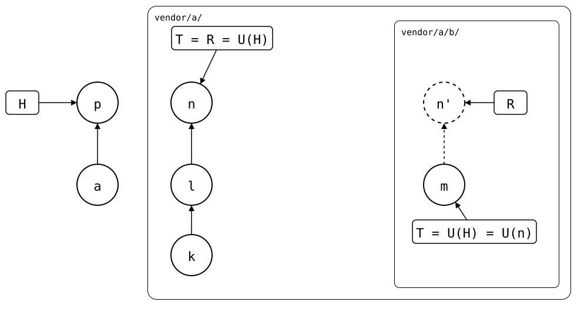

# Scenario: nested-splices, seen from the splice above

A nested splice is rebuilt recursively: the rebuild of `vendor/a/b/`
is made from the rebuild of `vendor/a/`, the commits the outer upstream
would get from a push, the way a clone of the outer upstream would
rebuild its `b/`. So only one level of nesting has to be right.

This page shows both rebuilds after a pull of `vendor/a/` that brings a
change to `b/`.

## Output

<!--
```scrut {fail_fast: true, output_stream: combined}
$ source "$TESTDIR/../../readme-setup.sh" && export GIT_CONFIG_COUNT=3 GIT_CONFIG_KEY_0="url.$UPSTREAM-b.git.insteadOf" GIT_CONFIG_VALUE_0=https://git.example.com/b.git GIT_CONFIG_KEY_1=user.name GIT_CONFIG_VALUE_1=Test GIT_CONFIG_KEY_2=user.email GIT_CONFIG_VALUE_2=test@example.com
```
-->

[`setup.bash`](setup.bash) builds the state of the [README](README.md):
the outer upstream with the inner one spliced in at `b/`, cloned into
the monorepo:

```scrut
$ build_scenario scenario_nested_splices https://git.example.com/b.git
```

In a clone of the outer upstream, a maintainer changes `b/`:

```scrut
$ git clone -q "$UPSTREAM" ../a-work &&
>   cd ../a-work &&
>   echo "b in a's upstream" >>b/file.txt &&
>   git -c user.name=Maintainer -c user.email=maintainer@example.com \
>     commit -q -am "b in a's upstream" &&
>   git push -q origin HEAD:main &&
>   cd ../monorepo
```

The monorepo pulls `vendor/a/`:

```scrut
$ git splice pull vendor/a
ok   vendor/a fetched (main moved * (glob)
ok   vendor/a/b fetched
ok   vendor/a: pulled * (glob)
```

<div align="center">



</div>

The monorepo's pull is *p*. In `vendor/a/`, the maintainer's commit is
*n* (`b in a's upstream`), and R is *n* itself. In
`vendor/a/b/`, R is *n'*: the copy of *n*, on top of *m*, which *n*'s
`b/.splice` still records.

<!--
```scrut
$ check_drawing "$TESTDIR/seen-from-above.drawio.svg" \
>   a=HEAD^ p=HEAD k=refs/splices/upstream/heads/main~2 \
>   l=refs/splices/upstream/heads/main~1 n=refs/splices/upstream/heads/main \
>   m=refs/splices/b/heads/main
ok   seen-from-above.drawio.svg: 7 commits, 8 arrows, 4 boxes, 2 lanes
```
-->

## The rebuild of `vendor/a/`

The monorepo has no changes of its own in `vendor/a/`, so its rebuild
is the outer upstream's `main`:

```scrut
$ git log --graph --format='%s (%an)' "$(git splice rebuild vendor/a)"
* b in a's upstream (Maintainer)
* add b (Test)
* a seed (Test)
```

## The rebuild of `vendor/a/b/`, made from it

Each commit of the rebuild of `vendor/a/` that changes `b/` becomes a commit of the inner
splice, with its author, on top of the inner upstream's commit the outer
upstream had at `b/`:

```scrut
$ git log --graph --format='%s (%an)' "$(git splice rebuild vendor/a/b)"
* b in a's upstream (Maintainer)
* b seed (Test)
```

The rebuild of `vendor/a/` has the commits the monorepo knows of, also
where a push of `vendor/a/` alone wouldn't send them: a change pushed to
the inner upstream that the outer upstream then got from someone else
stays in it ([pushed and made above](pushed-and-made-above.md)). A merge
in it becomes one commit of the inner splice, as any merge does
([changed above, in a merge](changed-above-in-a-merge.md)).
