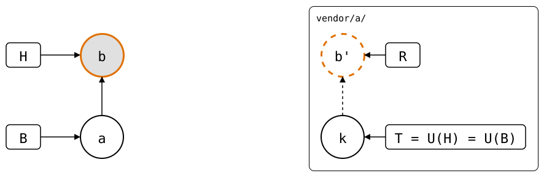

# Scenario: edited-before-push

The commits a push would send, R, are edited before they're pushed:
here, a message that names an internal ticket is reworded. They're
pushed with `git splice push --rebuilt-commit`. R is computed from the
monorepo's history, which still has the original commit, so a `pull`
right after the push records the edited commit as the synced commit. From there on, the monorepo
builds on the edited commit.

- **Monorepo (`vendor/a/`)**: *a* (`add vendor/a`) cloned *k*, then the
  unpushed commit *b* (`fix, see INTERNAL-123`).
- **Upstream**: *k* (`seed`).

<div align="center">



</div>

R is *b'*, the copy of *b* that the recipe edits.

The recipe:

1. Get R: `git splice rebuild` prints it.
2. Check it out in a worktree of its own: R has the upstream's layout,
   and a `git switch` would replace the monorepo's whole checkout.
3. Edit the commits after the synced commit U(H), e.g. with
   `git rebase -i`, and push the result with
   `git splice push --rebuilt-commit <commit> <path>`. It refuses a
   commit whose files differ from the folder's, or that doesn't contain
   U(H). Everything else about the commit is up to you: see
   [What push checks](#what-push-checks).

   Commits up to U(H) are on the upstream already. Editing those rewrites
   published history, so the push needs `--force` as well, which drops
   the check for U(H).

   Or push with plain Git, right from the worktree where you edited the
   commits: `git push <url> HEAD:<branch>`, with the upstream's URL from
   the splice's `.splice` file, e.g.
   `git config --blob HEAD:vendor/a/.splice upstream.origin.url` in the
   monorepo. Then nothing checks the commit, and `refs/splices` learns
   about it with the pull in step 4.
4. **`git splice pull --bump`**, before the next change to the splice.
   The folder has the pushed commit's files, so the pull records it as
   the synced commit. A plain pull does that too, unless the rebuild
   already contains the pushed commit, e.g. after dropping a commit and
   its revert. A change before the pull publishes the original commit
   after all: [change-before-the-pull](change-before-the-pull.md).

## What push checks

`git splice push` builds R itself and knows what it contains. A commit
given with `--rebuilt-commit` was made by hand, so push checks only what
a slip while editing would get wrong:

- **Its files are the folder's.** A file changed in the worktree would
  never reach the monorepo, and the next pull would merge it back in.
- **It contains U(H),** the merge base the next pull uses -- unless
  `--force` is given, which may replace U(H) and the commits before it, or
  the whole history: the pull right after the push records the commit
  as the new U(H) all the same.
- **A pull can record it.** A commit of R's history that isn't newer
  than U(H) -- U(H) itself, one before it, or one from a side branch of an
  earlier pull, e.g. after dropping commits that cancel each other out
  -- is one no pull records, so the next push would publish the dropped
  commits again. R itself needs no record.

The rest of its history goes upstream as it is, as with `git push`: its
parents, and the files of every commit before it. A merge that keeps
only R's files but has a monorepo commit as a parent passes both checks
and publishes the monorepo's history. So does a commit with a
`git replace` entry, whose original, not its replacement, is pushed.
Neither happens by accident while rewording or squashing. Whoever builds
the commit with Git's plumbing checks that it's the right one, e.g. with
`git log --graph <commit>` before the push.

## Output

<!--
```scrut {fail_fast: true, output_stream: combined}
$ source "$TESTDIR/../../readme-setup.sh"
```
-->

[`setup.bash`](setup.bash) builds this state:

```scrut
$ build_scenario scenario_edited_before_push
```

The drawing shows what Git and `git-splice` say about it, with each
commit named by its place in the history
([`check_drawing`](../../../../check-drawing/)):

```scrut
$ check_drawing "$TESTDIR/edited-before-push.drawio.svg" a=HEAD~1 b=HEAD k=refs/splices/upstream/main
ok   edited-before-push.drawio.svg: 4 commits, 6 arrows, 4 boxes, 1 lanes
```

### Edit and push

```scrut
$ R="$(git splice rebuild vendor/a)" && git log --oneline "$R"
700a8ff fix, see INTERNAL-123
bde4164 seed
```

```scrut
$ git worktree add -q -b edited ../edited "$R" && ls -A ../edited
.git
file.txt
```

```scrut
$ git -C ../edited commit -q --amend -m "fix the parser" && git splice push --rebuilt-commit edited vendor/a
ok   vendor/a: pushed ce80186 to main
??   vendor/a: run 'git splice pull --bump vendor/a' before the next change to it -- that records ce80186 as the synced commit
```

### Pull

The folder has the upstream's files, but R still has the original
commit, not the edited one. The pull records the edited commit, in a
commit that changes only `.splice`:

```scrut
$ git splice pull --bump vendor/a
ok   vendor/a fetched
ok   vendor/a: recorded ce80186 as the synced commit -- the folder already has its files
```

```scrut
$ git show --stat --format=%s HEAD
splice: pull vendor/a from main at ce80186

 vendor/a/.splice | 2 +-
 1 file changed, 1 insertion(+), 1 deletion(-)
```

### The next change builds on the edited commit

```scrut
$ echo "another fix" >>vendor/a/file.txt && git commit -q -a -m "another fix"
```

```scrut
$ git splice log vendor/a
===  vendor/a (main)
< bbd5c31 another fix  (Test <test@example.com>)
```

```scrut
$ git splice push vendor/a
ok   vendor/a: pushed bbd5c31 to main
```

```scrut
$ git -C "$UPSTREAM" log --graph --format=%s main
* another fix
* fix the parser
* seed
```
