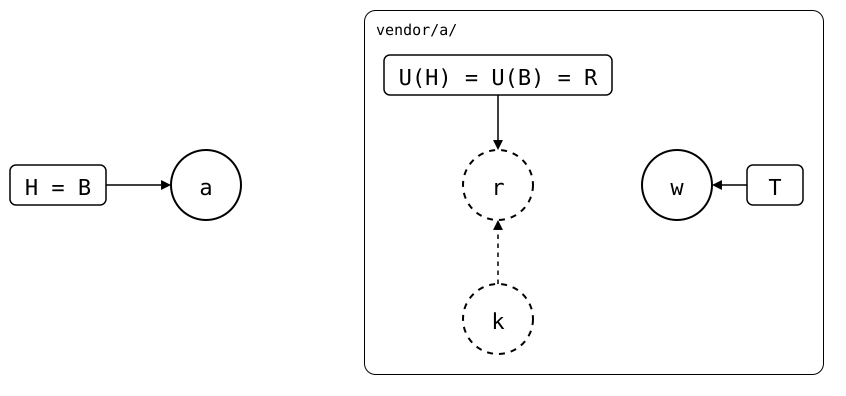

# Scenario: upstream-rewritten-equal-tree

The upstream rewrote its history and force-pushed a new commit with
exactly the same files. The splice looks up to date, but its synced commit
is no longer part of the upstream's history. A `merge` or `pull` records
the new commit as the synced commit, so the next change builds on the
rewritten history
([#17](https://github.com/roschaefer/git-splice/issues/17)).

<div align="center">



</div>

That only works while the folder still has the upstream's files. After a
local change, the splice is `unrelated history`, and `merge` and `pull`
refuse to guess. Then [keep the upstream's
version](keep-the-upstream-version.md) and redo the local changes on top
of it. If the rewrite removed something, like a secret, don't use the
other ways out that `merge` prints
([#38](https://github.com/roschaefer/git-splice/issues/38)).
`git splice push --force` rebuilds on top of the old synced commit, and
so [publishes the rewritten-away history
again](push-force-undoes-the-rewrite.md). Keeping both publishes the
monorepo's own history of the folder, which contains whatever the
monorepo pulled before the rewrite.

## Output

<!--
```scrut {fail_fast: true, output_stream: combined}
$ source "$TESTDIR/../../readme-setup.sh"
```
-->

[`setup.bash`](setup.bash) builds this state:

```scrut
$ build_scenario scenario_upstream_rewritten_equal_tree
```

<!--
```scrut
$ r="$(git config --file vendor/a/.splice splice.commit)"
```

```scrut
$ check_drawing "$TESTDIR/upstream-rewritten-equal-tree.drawio.svg"
ok   upstream-rewritten-equal-tree.drawio.svg: 4 commits, 4 arrows, 3 boxes, 1 lanes
```
-->

```scrut
$ git -C "$UPSTREAM" log --format=%s main
w: release, history rewritten
```

The splice is up to date: the folder has the upstream's files.

```scrut
$ git splice status
On branch main

  up to date  vendor/a
```

But `.splice` names the old release, *r*, which the upstream's history no
longer contains. The upstream's `main`, as fetched, is the ref ending in
`/main`:

```scrut
$ main="$(
>   git for-each-ref --format='%(refname:lstrip=4) %(objectname)' refs/splices/ |
>     sed -n 's#^main ##p'
> )"
```

```scrut
$ synced="$(git config --file vendor/a/.splice splice.commit)" &&
>   git merge-base --is-ancestor "$synced" "$main" || echo "not in the upstream's history"
not in the upstream's history
```

A `merge` records the rewritten commit as the synced commit, in a commit
that changes only `.splice`:

```scrut
$ git splice merge vendor/a
ok   vendor/a: recorded 5cc12da as the synced commit -- the folder already has its files
```

```scrut
$ git show --stat --format=%s HEAD
splice: merge vendor/a from main at 5cc12da

 vendor/a/.splice | 2 +-
 1 file changed, 1 insertion(+), 1 deletion(-)
```

A local change now builds on the rewritten history:

```scrut
$ echo "local change" >>vendor/a/file.txt && git commit -q -a -m "local change"
```

```scrut
$ git splice push vendor/a
ok   vendor/a: pushed 2a8eb25 to main
```

```scrut
$ git -C "$UPSTREAM" log --format=%s main
local change
w: release, history rewritten
```
