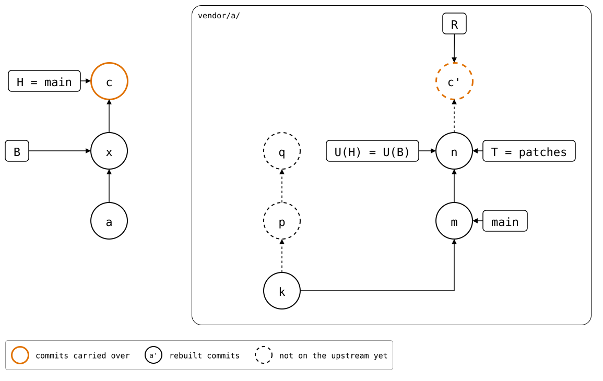
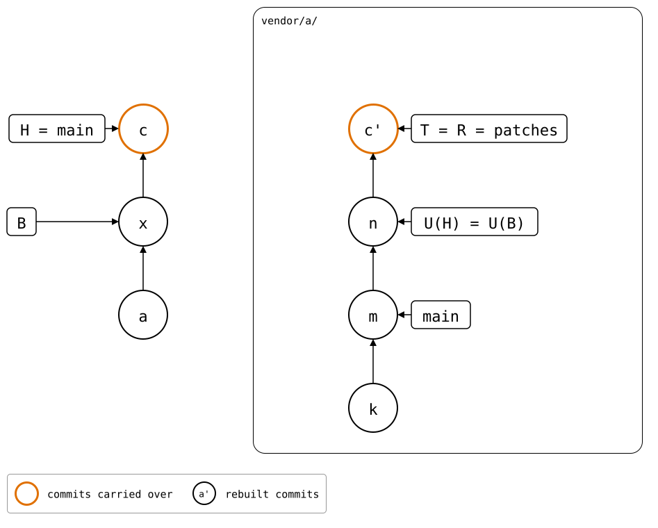

# Scenario: unpushed-local-commit

The [same state](../README.md), but the monorepo changed the folder
after *a*, in *b*, which adds `local.txt`, and didn't push the change
before the fork rebased `patches`:

<div align="center">


</div>

R is built on the old patches, which the rebase replaced. A merge
would get the files right,
*n*'s plus `local.txt`, but the rebuild can only start at T again where
the folder has exactly T's files. Here it would join *b'* in, and the
next push would publish *p* and *q* again, merged into the rebased
`patches`. So `pull` refuses.

The way out: `git splice pull --rebase` takes *n* in as the pull *x* on
top of *a*, and rebases *b* onto it as *c*. The folder at *x* has
exactly *n*'s files, so the rebuild starts at *n*: the next push sends
the local change alone, and *p* and *q* stay dropped. It rewrites the monorepo's branch, so it's for a
branch nobody else has yet: it refuses when a remote-tracking branch
has *b*. After the pull:

<div align="center">



</div>

Or avoid the refusal: push the local commits before the fork rebases
its branch. The rebased branch then has them, and the pull [goes
through](../README.md).

## Output

<!--
```scrut {fail_fast: true, output_stream: combined}
$ source "$TESTDIR/../../../readme-setup.sh"
```
-->

[`setup.bash`](setup.bash) builds this state:

```scrut
$ build_scenario scenario_unpushed_local_commit
```

<!--
```scrut
$ q="$(git config --file vendor/a/.splice splice.commit)"
```

```scrut
$ check_drawing "$TESTDIR/unpushed-local-commit.drawio.svg" b=HEAD q="$q" n=refs/splices/upstream/heads/patches
ok   unpushed-local-commit.drawio.svg: 8 commits, 12 arrows, 6 boxes, 1 lanes
```
-->

```scrut
$ git splice status
On branch main

  ahead 3, behind 2  vendor/a -> patches
```

```scrut
$ git splice pull vendor/a
ok   vendor/a fetched
!!   vendor/a: upstream rewrote 'patches' since f463f92, and the folder has changes 'patches' lacks -- run 'git splice pull --rebase vendor/a' to redo them on top: a pull now would publish the rewritten-away commits again with the next push
!!   Failed: vendor/a
[1]
```

Nothing changed:

```scrut
$ git log --format=%s
local change
a: add vendor/a
initial commit
```

### Redo the local change on top

With `--rebase`, the pull goes through:

```scrut
$ git splice pull --rebase -m "x: pull the rebased patches" vendor/a
ok   vendor/a fetched
ok   vendor/a: pulled 28d3fa4, and rebased 1 commit onto it
```

<!--
```scrut
$ check_drawing "$TESTDIR/rebased-onto-pull.drawio.svg" c=HEAD \
>   p="$q~1" q="$q" n=refs/splices/upstream/heads/patches
ok   rebased-onto-pull.drawio.svg: 9 commits, 13 arrows, 6 boxes, 1 lanes
```
-->

Only the local change is ahead now, and the pull comes before it:

```scrut
$ git splice status
On branch main

  ahead 1  vendor/a -> patches
```

```scrut
$ git log --format=%s
local change
x: pull the rebased patches
a: add vendor/a
initial commit
```

```scrut
$ git splice push vendor/a
ok   vendor/a: pushed c6117f0 to patches
```

The rebased branch gets the change on top, and *p* and *q* stay
dropped:

```scrut
$ git -C "$UPSTREAM" log --format=%s patches
local change
other patch
m: patch, reworded upstream
k: seed
```

The push records nothing, so U(H) is still *n*, the commit the pull
took, until the next pull:

<div align="center">



</div>

<!--
```scrut
$ check_drawing "$TESTDIR/redone-on-top.drawio.svg" c=HEAD n=refs/splices/upstream/heads/patches~1
ok   redone-on-top.drawio.svg: 7 commits, 10 arrows, 5 boxes, 1 lanes
```
-->
