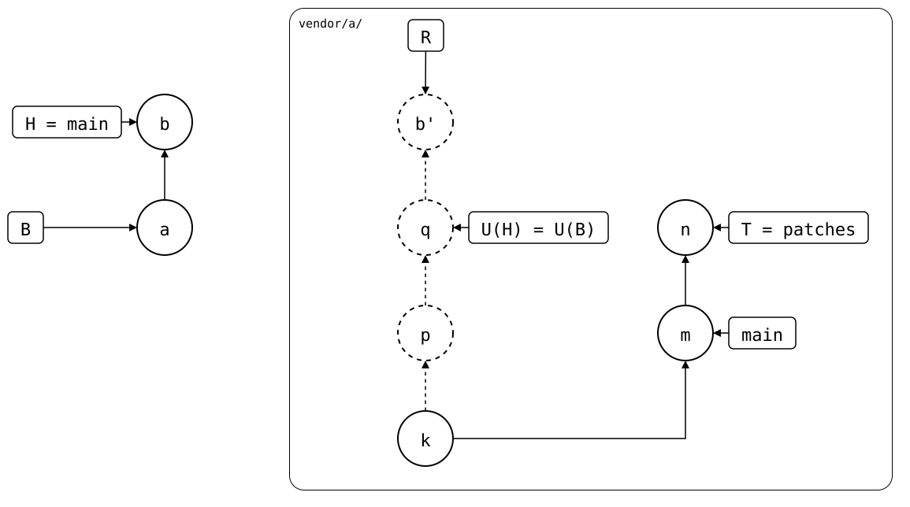

# Scenario: unpushed-local-commit

The [same state](../README.md), but the monorepo changed the folder
after *a*, and didn't push the change before the fork rebased
`patches`.

- **Monorepo (`vendor/a/`)**: *a* (`add vendor/a`) cloned *p*, then the
  unpushed commit *b* (`local change`), which adds `local.txt`.
- **Upstream**: as before, `patches` rebased from *p* onto *m*.

<div align="center">



</div>

R, what a push would send, is *b'* on top of U(H), *p*: the old patch,
which the upstream dropped. A merge would get the files right, *m*'s
plus `local.txt`, but the rebuild can only start at T again where the
folder has exactly T's files. Here it would join *b'* in, and the next
push would publish *p* again, the patch the upstream dropped, merged into
the rebased `patches`. So `pull` refuses.

The way out: [redo the local change on top](redo-on-top.md) of the
rebased branch. Or avoid it: push the local commits before the fork
rebases its branch. The rebased branch then has them, and the pull
[goes through](../README.md).

## Output

<!--
```scrut {fail_fast: true, output_stream: combined}
$ source "$TESTDIR/../../../readme-setup.sh"
```
-->

[`setup.bash`](setup.bash) builds this state:

```scrut
$ build_scenario scenario_unpushed_local_commit
```

```scrut
$ p="$(git config --file vendor/a/.splice splice.commit)"
```

```scrut
$ check_drawing "$TESTDIR/unpushed-local-commit.drawio.svg" a=HEAD~1 b=HEAD k="$p~1" p="$p" m=refs/splices/upstream/patches
ok   unpushed-local-commit.drawio.svg: 6 commits, 9 arrows, 5 boxes, 1 lanes
```

```scrut
$ git splice status
On branch main

  ahead 2, behind 1  vendor/a -> patches
```

```scrut
$ git splice pull vendor/a
ok   vendor/a fetched
!!   vendor/a: upstream rewrote 'patches' since the synced commit 2aff4fd, and the folder has changes 'patches' lacks -- set them aside, pull, and redo them on top: a pull now would publish the rewritten-away commits again with the next push
!!   Failed: vendor/a
[1]
```

Nothing changed:

```scrut
$ git log --format=%s
local change
add vendor/a
initial commit
```
