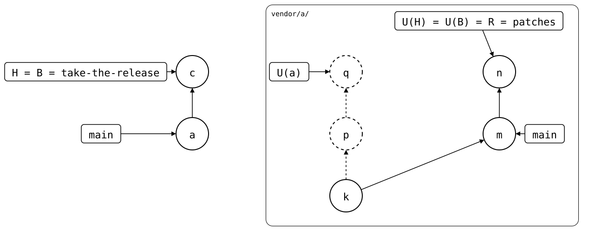
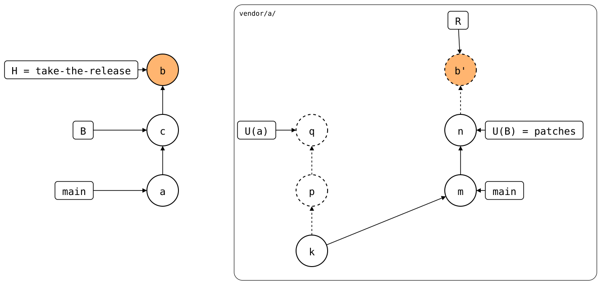
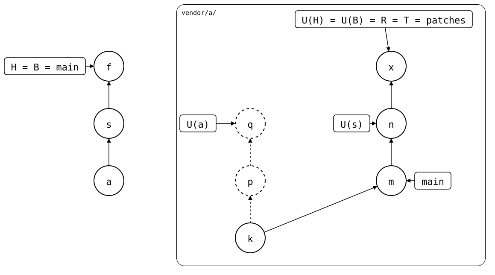

# Scenario: squash-merged

The [same rebased branch](../README.md), taken into a protected `main`:
changes reach it only through pull requests, which are squash-merged.
This page goes there step by step, with a drawing after each.

- **Monorepo (`vendor/a/`)**: *a* cloned *q*, and
  follows `patches` on `main`.
- **Upstream**: *k*, then `patches` rebased from *p* and *q* to *n*, on
  top of `main`'s *m*. *q* and *n* are the same patch, `other patch`.

## 1. Pull on a pull request's branch

A pull request's branch syncs with the upstream branch named like it,
and the upstream has none for `take-the-release`. `--branch patches`
names the branch `main` follows, for this pull only. The pull makes *c*,
which records *n*. The
folder has exactly *n*'s files, so R is *n*, and *p* and *q* stay
dropped:

<div align="center">



</div>

## 2. Add a local change

A local change goes on top, *b*. On this branch, R is
*b'* on top of *n*: linear, just right.

<div align="center">



</div>

## 3. Squash-merge it

The squash merge puts *c* and *b* into one commit on `main`, *s*. It records
*n*, but its folder is *n*'s plus `local.txt`. The synced commit before
it, *a*'s *q*, isn't in *n*'s history: the upstream rewrote `patches`
in between. A rebuild would have to join *s* with the history before
it, still built on *p* and *q*, and the next push would publish them
again. Nothing can rewrite *s* on a protected `main`, so `status` and
`push` refuse, and say the way out.

A pull request that only pulls goes through: its squash merge has
exactly *n*'s files, and the rebuild starts at *n*. So take the release
in a pull request of its own, and the local changes in the next one.

## 4. The way out, by hand

Commit the folder's changes on top of `patches` in a clone of the
upstream, push them, and pull: the pull records the new commit, *x*,
in *f*, and the folder already has its files. The rebuild starts at *x*, and
*p* and *q* stay dropped. On a protected `main`, *f* goes through a
pull request of its own too: it only changes `.splice`.

<div align="center">



</div>

## Output

<!--
```scrut {fail_fast: true, output_stream: combined}
$ source "$TESTDIR/../../../readme-setup.sh"
```
-->

[`setup.bash`](setup.bash) builds the [rebased branch](../README.md):

```scrut
$ build_scenario scenario_squash_merged
```

<!--
```scrut
$ q="$(git config --file vendor/a/.splice splice.commit)"
```
-->

### 1. Pull on a pull request's branch

Without `--branch`, there's nothing to pull:

```scrut
$ git switch -q -c take-the-release && git splice pull vendor/a
ok   vendor/a fetched
ok   vendor/a: upstream has no 'take-the-release' branch -- nothing to pull
```

```scrut
$ git splice pull --branch patches -m "c: pull the release" vendor/a
ok   vendor/a fetched
ok   vendor/a: pulled 28d3fa4
```

<!--
```scrut
$ check_drawing "$TESTDIR/pulled-on-pull-request.drawio.svg" a=main p="$q~1" q="$q" n=refs/splices/upstream/heads/patches
ok   pulled-on-pull-request.drawio.svg: 7 commits, 10 arrows, 5 boxes, 1 lanes
```
-->

### 2. Add a local change

```scrut
$ echo "local change" >vendor/a/local.txt && git add vendor/a/local.txt && git commit -q -m "b: local change"
```

<!--
```scrut
$ check_drawing "$TESTDIR/pull-request.drawio.svg" a=main p="$q~1" q="$q" n=refs/splices/upstream/heads/patches
ok   pull-request.drawio.svg: 9 commits, 14 arrows, 7 boxes, 1 lanes
```
-->

```scrut
$ git log --format=%s "$(git splice rebuild vendor/a)"
b: local change
other patch
m: patch, reworded upstream
k: seed
```

### 3. Squash-merge it

```scrut
$ git switch -q main && git merge -q --squash take-the-release >/dev/null && git commit -q -m "s: take the release, and a local change (#1)"
```

```scrut
$ git log --format=%s
s: take the release, and a local change (#1)
a: add vendor/a
initial commit
```

```scrut
$ git splice status
!!   vendor/a: [0-9a-f]{7} records 28d3fa4, which the upstream rewrote from f463f92, and has changes of its own -- commit the folder's changes on top of the upstream branch yourself, push them there, then pull: the rebuild would publish the rewritten-away commits again (regex)
[1]
```

```scrut
$ git splice push vendor/a
!!   vendor/a: [0-9a-f]{7} records 28d3fa4, which the upstream rewrote from f463f92, and has changes of its own -- commit the folder's changes on top of the upstream branch yourself, push them there, then pull: the rebuild would publish the rewritten-away commits again (regex)
!!   Failed: vendor/a
[1]
```

### 4. The way out, by hand

```scrut
$ git clone -q -b patches "$UPSTREAM" ../fork && git -C ../fork config user.name "$(git config user.name)" && git -C ../fork config user.email "$(git config user.email)"
```

The folder's changes since the synced commit, without `.splice`, on top
of `patches`:

```scrut
$ git diff --binary "$(git config --file vendor/a/.splice splice.commit)" HEAD:vendor/a -- . ':!.splice' | git -C ../fork apply
```

```scrut
$ git -C ../fork add -A && git -C ../fork commit -q -m "x: local change" && git -C ../fork push -q origin HEAD:patches
```

```scrut
$ git splice pull -m "f: record x" vendor/a
ok   vendor/a fetched (patches moved 28d3fa4..d56a92e)
ok   vendor/a: recorded d56a92e as the synced commit -- the folder already has its files
```

<!--
```scrut
$ check_drawing "$TESTDIR/fixed-by-hand.drawio.svg" p="$q~1" q="$q" n=refs/splices/upstream/heads/patches~1
ok   fixed-by-hand.drawio.svg: 9 commits, 12 arrows, 5 boxes, 1 lanes
```
-->

```scrut
$ git splice status
On branch main

  up to date  vendor/a -> patches
```

```scrut
$ git log --format=%s "$(git splice rebuild vendor/a)"
x: local change
other patch
m: patch, reworded upstream
k: seed
```
