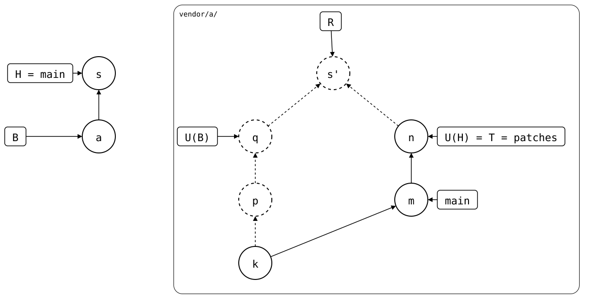

# Scenario: squash-merged

The [same rebased branch](../README.md), taken into a protected `main`:
changes reach it only through pull requests, which are squash-merged.

A pull request's branch can't pull `patches`: it syncs with the upstream
branch named like it, and the upstream has none. So the pull happens on
a local `main`, its commit moves to the pull request's branch, and a
local change goes on top. The squash merge puts both into one commit on
`main`, *s* (`vendor/a: take the release, and a local change (#1)`).

- **Monorepo (`vendor/a/`)**: *a* (`add vendor/a`) cloned *p*, then *s*,
  which records *m* as the synced commit, with *m*'s files plus
  `local.txt`.
- **Upstream**: as before, `patches` rebased from *p* onto *m*.

<div align="center">



</div>

R, what a push would send, is *s'*, a merge of *p* and *m*. The next
push publishes *p* again, the patch the upstream dropped. B, where the
rebuild starts, is still *a*, so it starts at U(B), *p*. At *s*, it
joins in U(H), *m*, as a merge: *s*'s folder isn't *m*'s, so it can't
start over at *m* alone.

**To decide:**

1. **Which upstream branch a pull request's branch pulls.** Today, the
   one named like it, or nothing. Taking the one `main` follows when the
   upstream has none would let the pull happen on the pull request's
   branch, where `pull --rebase` could rewrite it.
2. **What the rebuild makes of *s*.** *s* records *m*, which doesn't
   contain *p*, the synced commit before it: the upstream rewrote its
   branch between the two. A rule that the monorepo's history alone
   decides: at such a commit, the rebuild starts at its synced commit
   and copies the commit on top of it, without what came before. R
   would be *s'* on top of *m*, and *p* would stay dropped. Unpushed
   changes before *s* stay in *s'*'s files, but not as commits of their
   own.

## Output

<!--
```scrut {fail_fast: true, output_stream: combined}
$ source "$TESTDIR/../../../readme-setup.sh"
```
-->

[`setup.bash`](setup.bash) builds this state:

```scrut
$ build_scenario scenario_squash_merged
```

On a pull request's branch, there's nothing to pull:

```scrut
$ git switch -q -c another-pull-request && git splice pull vendor/a; git switch -q main
ok   vendor/a fetched
ok   vendor/a: upstream has no 'another-pull-request' branch -- nothing to pull
```

`main` has the squash commit:

```scrut
$ git log --format=%s
vendor/a: take the release, and a local change (#1)
add vendor/a
initial commit
```

```scrut
$ git config --file vendor/a/.splice splice.commit
97171d64c3d723e97c82ca4bcd06c641aa58a112
```

*a* recorded *p*:

```scrut
$ p="$(git config --blob HEAD~1:vendor/a/.splice splice.commit)"
```

```scrut
$ check_drawing "$TESTDIR/squash-merged.drawio.svg" a=HEAD~1 s=HEAD k="$p~1" p="$p" m=refs/splices/upstream/patches
ok   squash-merged.drawio.svg: 6 commits, 10 arrows, 5 boxes, 1 lanes
```

```scrut
$ git splice status
On branch main

  ahead 2  vendor/a -> patches
```

R joins *p* in again:

```scrut
$ git log --graph --format=%s "$(git splice rebuild vendor/a)"
*   vendor/a: take the release, and a local change (#1)
|\  
| * patch, reworded upstream
* | patch
|/  
* seed
```
