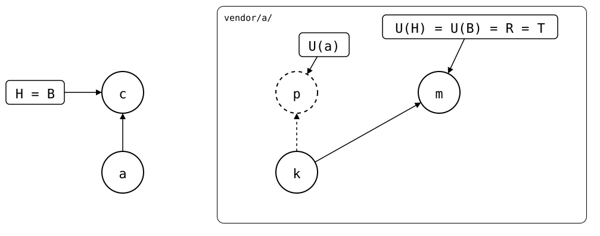
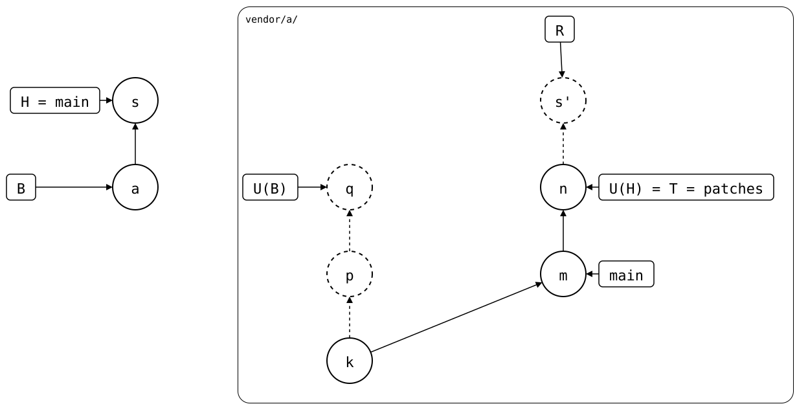

# Scenario: squash-merged

The [same rebased branch](../README.md), taken into a protected `main`:
changes reach it only through pull requests, which are squash-merged.
This page goes there step by step, with a drawing after each.

- **Monorepo (`vendor/a/`)**: *a* (`add vendor/a`) cloned *q*, and
  follows `patches` on `main`.
- **Upstream**: *k* (`seed`), then `patches` rebased from *p* (`patch`)
  and *q* (`other patch`) to *n* (`other patch`), on top of `main`'s *m*
  (`patch, reworded upstream`).

## 1. Pull on a local `main`

A pull request's branch can't pull `patches`: it syncs with the upstream
branch named like it, and the upstream has none. So the pull happens on
a local `main`. It makes *c* (`splice: pull vendor/a from patches at
n`), which records *n*. The folder has exactly *n*'s files, so R is *n*,
and *p* and *q* stay dropped:

<div align="center">



</div>

## 2. Move it to a pull request

`main` is protected, so *c* moves to a pull request's branch,
`take-the-release`, and a local change goes on top, *b* (`local
change`). On this branch, R is *b'* on top of *n*: linear, just right.

<div align="center">


</div>

## 3. Squash-merge it

The squash merge puts *c* and *b* into one commit on `main`, *s*
(`vendor/a: take the release, and a local change (#1)`). It records
*n*, but its folder is *n*'s plus `local.txt`.

<div align="center">


</div>

R is now *s'*, a merge of *q* and *n*: the next push publishes *p* and
*q* again, the commits the rebase replaced. On `main`, *c* is gone, so
B, where the rebuild starts, is still *a*, and the rebuild starts at
U(B), *q*. At *s*, it joins in U(H), *n*, as a merge: *s*'s folder
isn't *n*'s, so it can't start over at *n* alone.

## To decide

1. **Which upstream branch a pull request's branch pulls.** Today, the
   one named like it, or nothing (step 1). Proposed: `git splice pull
   --branch patches` names it for that one pull, without writing it to
   `.splice`. The pull could then happen on the pull request's branch,
   where `pull --rebase` could rewrite it.
2. **What the rebuild makes of *s*.** *s* records *n*, which doesn't
   contain *q*, the synced commit before it: the upstream rewrote its
   branch between the two. A rule that the monorepo's history alone
   decides: at such a commit, the rebuild starts at its synced commit
   and copies the commit on top of it, without what came before. R would
   be *s'* on top of *n*, as in step 2, and *p* and *q* would stay
   dropped:

   <div align="center">

   

   </div>

   This drawing shows the proposal, not what the code does, so nothing
   checks it. Unpushed changes before *s* would stay in *s'*'s files, but
   not as commits of their own.

## Output

<!--
```scrut {fail_fast: true, output_stream: combined}
$ source "$TESTDIR/../../../readme-setup.sh"
```
-->

[`setup.bash`](setup.bash) builds the [rebased branch](../README.md):

```scrut
$ build_scenario scenario_squash_merged
```

```scrut
$ q="$(git config --file vendor/a/.splice splice.commit)"
```

### 1. Pull on a local `main`

On a pull request's branch, there's nothing to pull:

```scrut
$ git switch -q -c another-pull-request && git splice pull vendor/a; git switch -q main
ok   vendor/a fetched
ok   vendor/a: upstream has no 'another-pull-request' branch -- nothing to pull
```

On `main`, there is:

```scrut
$ git splice pull vendor/a
ok   vendor/a fetched
ok   vendor/a: pulled 63b44f3
```

```scrut
$ check_drawing "$TESTDIR/pulled-on-main.drawio.svg" a=HEAD~1 c=HEAD k="$q~2" p="$q~1" q="$q" m=refs/splices/upstream/main n=refs/splices/upstream/patches
ok   pulled-on-main.drawio.svg: 7 commits, 9 arrows, 4 boxes, 1 lanes
```

### 2. Move it to a pull request

```scrut
$ git switch -q -c take-the-release && git switch -q main && git reset -q --hard HEAD~1 && git switch -q take-the-release
```

```scrut
$ echo "local change" >vendor/a/local.txt && git add vendor/a/local.txt && git commit -q -m "local change"
```

```scrut
$ check_drawing "$TESTDIR/pull-request.drawio.svg" a=HEAD~2 c=HEAD~1 b=HEAD k="$q~2" p="$q~1" q="$q" m=refs/splices/upstream/main n=refs/splices/upstream/patches
ok   pull-request.drawio.svg: 9 commits, 14 arrows, 7 boxes, 1 lanes
```

```scrut
$ git log --format=%s "$(git splice rebuild vendor/a)"
local change
other patch
patch, reworded upstream
seed
```

### 3. Squash-merge it

```scrut
$ git switch -q main && git merge -q --squash take-the-release >/dev/null && git commit -q -m "vendor/a: take the release, and a local change (#1)"
```

```scrut
$ git log --format=%s
vendor/a: take the release, and a local change (#1)
add vendor/a
initial commit
```

```scrut
$ check_drawing "$TESTDIR/squash-merged.drawio.svg" a=HEAD~1 s=HEAD k="$q~2" p="$q~1" q="$q" m=refs/splices/upstream/main n=refs/splices/upstream/patches
ok   squash-merged.drawio.svg: 8 commits, 13 arrows, 6 boxes, 1 lanes
```

```scrut
$ git splice status
On branch main

  ahead 3  vendor/a -> patches
```

R joins *p* and *q* in again:

```scrut
$ git log --graph --format=%s "$(git splice rebuild vendor/a)"
*   vendor/a: take the release, and a local change (#1)
|\  
| * other patch
| * patch, reworded upstream
* | other patch
* | patch
|/  
* seed
```
