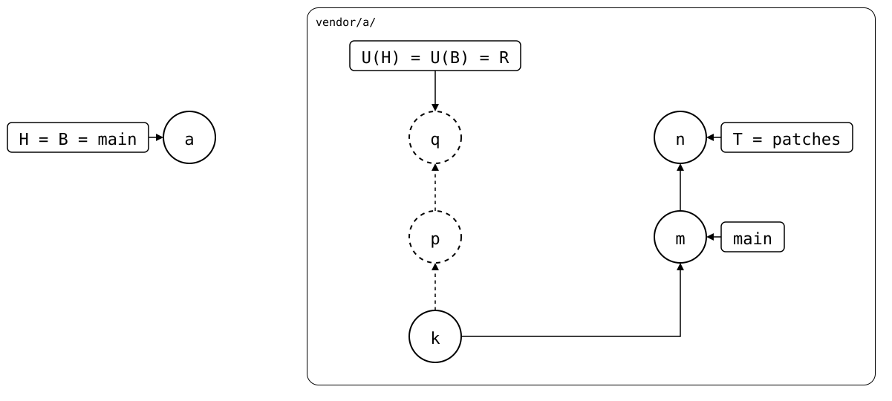
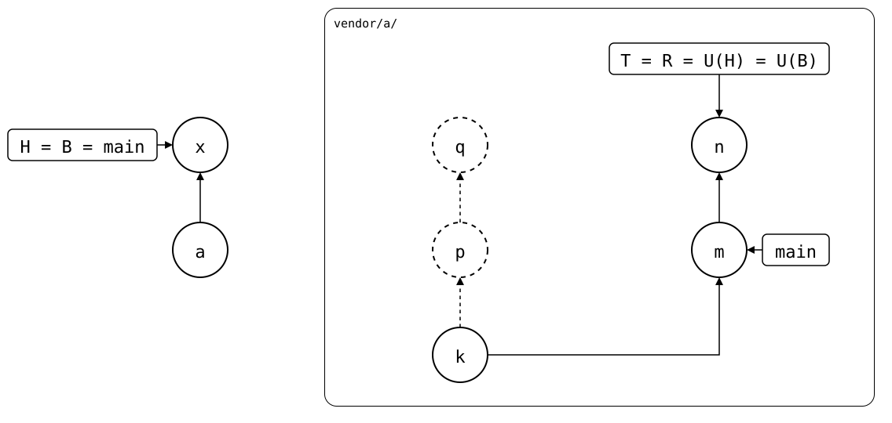

# Scenario: patch-branch-rebased

A fork carries patches of its own on a branch, `patches`, on top of the
upstream's `main`, and the monorepo's `main` follows that branch
instead of the upstream's `main`. When the upstream releases, the fork
rebases `patches` onto the new `main`. Patches the upstream took drop
out, the others get new commits. Either way, the commit the monorepo
synced last is on no upstream branch any more
([#169](https://github.com/roschaefer/git-splice/issues/169)).

- **Monorepo (`vendor/a/`)**: *a* cloned *q* from
  `patches`, and follows `patches` on `main`.
- **Upstream** (`$UPSTREAM`, reached as `https://git.example.com/a.git`):
  *k* on `main`, and two patches on top of it on
  `patches`: *p* and *q* (`other patch`). Then `main` takes
  the first patch reworded, *m*, and
  `patches` is rebased onto it: *p* drops out, and the other patch gets
  a new commit, *n* (`other patch`), on top of *m*. Already fetched.

<div align="center">



</div>

U(H) is *q*, but T is *n*, and no upstream branch has *p* or *q* any
more, so they're dashed. Git's merge base of the two is *k*, from before
the patches: merging from there, the first patch and its rewording would
be changes on both sides, and conflict. Like `git pull --rebase`, a
`pull` merges from the branch's fork point instead: where the fetched
`patches` was before the rebase, *q*, as the ref's reflog has it. Those
are the files the monorepo took last, so the upstream's new version
simply replaces them.

Another upstream's commit, like a fork's patch the original never had,
isn't rewritten away: the original's fetched branch never pointed at it
([original-without-the-patch](../../04-upstreams/02-several-upstreams/01-original-without-the-patch/README.md)).

The reflog is local, as in Git: a clone of the monorepo that first
fetched after the rebase has no *q* in it, and its pull conflicts as
`git merge` would. So does `git splice pull --no-fork-point`.

That's only safe as long as everything the monorepo changed in the
folder is pushed, so the rebased branch has it. An [unpushed local
commit](01-unpushed-local-commit/README.md) is a different story.

## Output

<!--
```scrut {fail_fast: true, output_stream: combined}
$ source "$TESTDIR/../../readme-setup.sh" && export GIT_CONFIG_COUNT=1 GIT_CONFIG_KEY_0="url.$UPSTREAM.insteadOf" GIT_CONFIG_VALUE_0=https://git.example.com/a.git
```
-->

[`setup.bash`](setup.bash) builds this state:

```scrut
$ build_scenario scenario_patch_branch_rebased https://git.example.com/a.git
```

On the monorepo's default branch, a splice syncs with its upstream's
`default-branch`. Setting it to the fork's patch branch makes `main`
follow that branch, for `pull`, `push` and `status` alike:

```scrut
$ cat vendor/a/.splice
[splice]
	commit = f463f92ba0f70a0da1ffaa64c5af8e3b64f04c55
	id = db77d5957130b5d2
[upstream "origin"]
	url = https://git.example.com/a.git
	default-branch = patches
```

<!--
```scrut
$ q="$(git config --file vendor/a/.splice splice.commit)"
```

```scrut
$ check_drawing "$TESTDIR/patch-branch-rebased.drawio.svg" q="$q" n=refs/splices/a/heads/patches
ok   patch-branch-rebased.drawio.svg: 6 commits, 8 arrows, 4 boxes, 1 lanes
```
-->

```scrut
$ git -C "$UPSTREAM" log --format=%s patches
other patch
m: patch, reworded upstream
k: seed
```

```scrut
$ git splice status
On branch main

  ahead 2, behind 2  vendor/a -> patches
```

`ahead 2` are *p* and *q*: the rebased branch lacks them, though the
monorepo has nothing to push. That count is misleading after a rewrite upstream.

The fetched branch's reflog has both *n* and *q*, where `patches` was
before, each with the subject `other patch`:

```scrut
$ git log -g --format='%h %s' refs/splices/a/heads/patches
28d3fa4 other patch
f463f92 other patch
```

```scrut
$ [ "$(git merge-base --fork-point refs/splices/a/heads/patches "$(git splice rebuild vendor/a)")" = "$(git config --file vendor/a/.splice splice.commit)" ] &&
>   echo "the fork point is q"
the fork point is q
```

```scrut
$ git splice pull -m "x: pull the rebased patches" vendor/a
ok   vendor/a fetched
ok   vendor/a: pulled 28d3fa4
```

The folder has the upstream's version of the first patch, and the other
patch as before:

```scrut
$ cat vendor/a/file.txt vendor/a/other.txt
k: seed
m: patch, reworded upstream
other patch
```

```scrut
$ git splice status
On branch main

  up to date  vendor/a -> patches
```

R, what a push would send, is the upstream's branch itself: the old
patches, *p* and *q*, don't come back.

```scrut
$ [ "$(git splice rebuild vendor/a)" = "$(git rev-parse refs/splices/a/heads/patches)" ] && echo "R is T"
R is T
```

Why one `pull` is enough: since it took *q*, the monorepo changed
nothing in `vendor/a/`. Merging from *q*, only the upstream changed
something, from *q* to *n*, so the merge takes all of it, without a
conflict. From *k*, Git's merge base, the first patch would be a change
on both sides. The pull, *x*, then records *n* in `.splice`: H and B are
*x*, U(H) = U(B) = *n*. The rebuild starts at *n* and adds nothing, so
R is T, and `status` has nothing ahead. *p* and *q* are in neither
history any more:

<div align="center">



</div>

<!--
```scrut
$ check_drawing "$TESTDIR/pulled.drawio.svg" p="$q~1" q="$q" n=refs/splices/a/heads/patches
ok   pulled.drawio.svg: 7 commits, 8 arrows, 3 boxes, 1 lanes
```
-->
