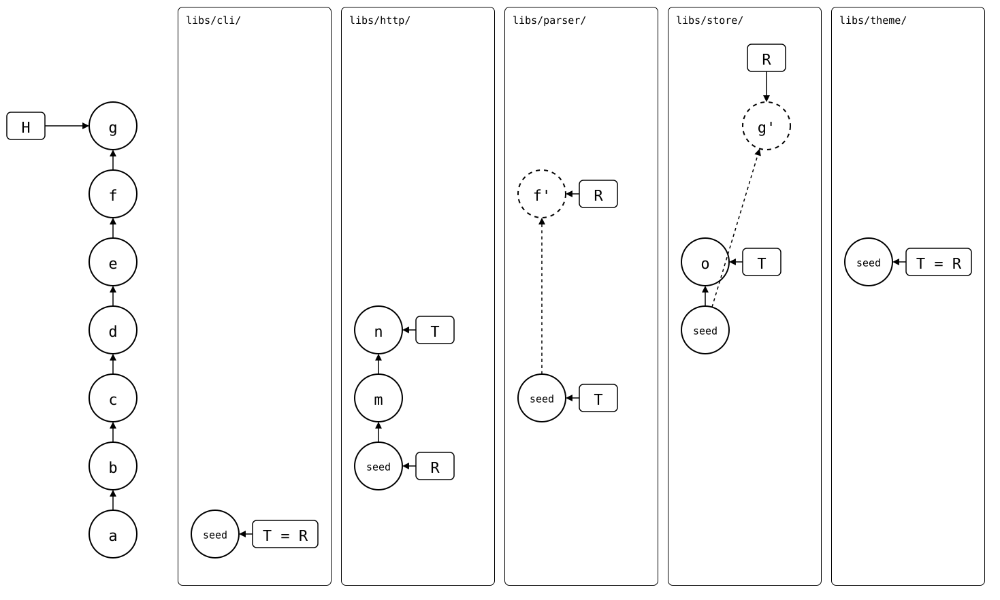

# Scenario: many-splices

A monorepo with five splices, each in a different state, on the
monorepo's default branch.

- **Monorepo (`libs/*`)**: *a* to *e* add `cli`, `http`, `parser`, `store`
  and `theme`, each from its own upstream's `seed`. Then a local commit
  in `parser`, *f*, and one in `store`, *g*.
- **Upstreams**: two new commits in `http`'s, *m* and *n*, one in
  `store`'s, *o*. `theme`'s default branch is `master`.

`status` gives every splice a line. Those that need something come first,
most urgent first: diverged, then behind, then ahead. Those with nothing
to do come last, after a blank line. A splice names its upstream branch
only where it differs from the monorepo's, like `theme`'s `master`.

The other documents here show the same monorepo
[on a feature branch](feature-branch.md),
[with uncommitted changes](uncommitted-changes.md) and
[in a fresh clone](fresh-clone.md).

<div align="center">



</div>

Each splice has a lane, labelled with its folder. *f'* and *g'* are R's
copies of *f* and *g*.

## Output

<!--
```scrut {fail_fast: true, output_stream: combined}
$ source "$TESTDIR/../readme-setup.sh"
```
-->

[`setup.bash`](setup.bash) builds this state:

```scrut
$ build_scenario scenario_many_splices
```

The drawing shows what Git and `git-splice` say about it, with each
commit named by its place in the history
([`check_drawing`](../../../check-drawing/)):

```scrut
$ check_drawing "$TESTDIR/many-splices.drawio.svg" a=HEAD~6 b=HEAD~5 c=HEAD~4 d=HEAD~3 e=HEAD~2 f=HEAD~1 g=HEAD m=refs/splices/upstream-http/main~1 n=refs/splices/upstream-http/main o=refs/splices/upstream-store/main
ok   many-splices.drawio.svg: 17 commits, 20 arrows, 9 boxes, 5 lanes
```

```scrut
$ git splice status
On branch main

  ahead 1, behind 1  libs/store
  behind 2           libs/http
  ahead 1            libs/parser

  up to date         libs/cli
  up to date         libs/theme -> master
```
