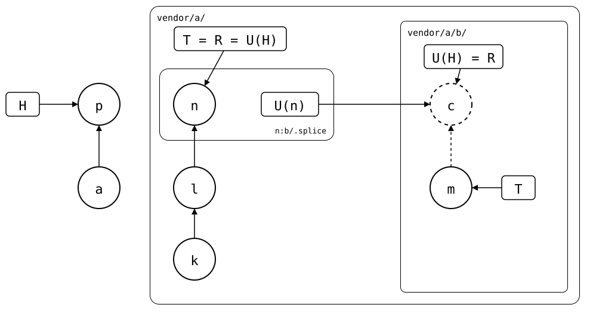

# Scenario: nested-splices, a synced commit b's upstream dropped

a's upstream pulls a change of b into `b/`, then b's upstream drops that
change from its `main`, e.g. by a force-push. The synced commit a's
upstream records for b is on no branch of b's upstream any more
([#126](https://github.com/roschaefer/git-splice/issues/126)).

A pull fetches b before it pulls a, so that fetch can't ask for the
synced commit a's pull moves b to. A pull of b afterwards fetches it by
its hash. Before, b was reported as sharing no history with its
upstream, with advice that included overwriting the upstream's branch.

## Output

<!--
```scrut {fail_fast: true, output_stream: combined}
$ source "$TESTDIR/../readme-setup.sh" && export GIT_CONFIG_COUNT=3 GIT_CONFIG_KEY_0="url.$UPSTREAM-b.git.insteadOf" GIT_CONFIG_VALUE_0=https://git.example.com/b.git GIT_CONFIG_KEY_1=user.name GIT_CONFIG_VALUE_1=Test GIT_CONFIG_KEY_2=user.email GIT_CONFIG_VALUE_2=test@example.com
```
-->

[`setup.bash`](setup.bash) builds the state of the [README](README.md):
a with b spliced in at `b/`, cloned into the monorepo:

```scrut
$ build_scenario scenario_nested_splices https://git.example.com/b.git
```

## b's upstream drops a change a's upstream has

A change in b's upstream, *c* (`b change`), on top of *m* (`b seed`):

```scrut
$ seed_bare_repo "$UPSTREAM-b.git" "b change" main other.txt >/dev/null 2>&1
```

In a clone of a's upstream, b pulls it, and a's upstream gets it as *n*,
on top of *k* (`a seed`) and *l* (`add b`):

```scrut
$ git clone -q "$UPSTREAM" ../a-work && cd ../a-work && git splice pull b && git push -q origin HEAD:main && cd ../monorepo
ok   b fetched
ok   b: pulled 95165ad
```

b's upstream drops *c* again:

```scrut
$ git -C "$UPSTREAM-b.git" update-ref refs/heads/main refs/heads/main^
```

## Pulling both

```scrut
$ git splice pull --all
ok   vendor/a fetched (main moved *..*) (glob)
ok   vendor/a/b fetched
ok   vendor/a: pulled * (glob)
ok   vendor/a/b fetched
ok   vendor/a/b: nothing to pull
```

The pull of a is *p*, on top of the monorepo's *a* (`add vendor/a`):

<div align="center">



</div>

*n*'s `b/.splice` records *c*: U(n) = *c*, and so does *p*'s
`vendor/a/b/.splice`, U(H). *c* is dashed: no branch of b's upstream has
it any more, but the pull fetched it by its hash. The drawing shows what Git
and `git-splice` say about it
([`check_drawing`](../../../check-drawing/)):

```scrut
$ check_drawing "$TESTDIR/dropped-below.drawio.svg" a=HEAD^ p=HEAD k=refs/splices/upstream/main~2 l=refs/splices/upstream/main~1 n=refs/splices/upstream/main m=refs/splices/b/main c="$(git config --file vendor/a/b/.splice splice.commit)"
ok   dropped-below.drawio.svg: 7 commits, 8 arrows, 4 boxes, 2 lanes
```

*c* is in b's rebuild, R, and b's upstream lacks it, so the next push of
b brings it back:

```scrut
$ git splice status
On branch main

  ahead 1     vendor/a/b

  up to date  vendor/a
```
