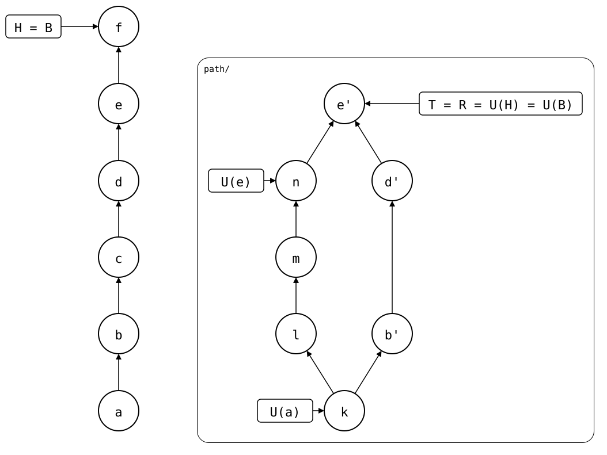

# Scenario: pushed-and-bumped

The [parent scenario](../README.md) after `git splice push` and a
`git splice pull --bump`. The commits are named as in the drawing:

<div align="center">



</div>

- **Monorepo (`vendor/a/`)**: the parent scenario's commits, then f, the
  bump, which records e' in `.splice` and changes nothing else.
- **Upstream**: k, l, m and n, then the pushed b', d' and e'.

The push made b', d' and e' upstream commits, so they're drawn solid.
The bump made f the new B: its folder is e', the commit it records. So
the rebuild starts at f, and has nothing to add: R = T = U(H) = U(B) = e'.
Each frame shows a sync point along the way: U(a) = k from the clone,
U(e) = n from the pull, and U(f) = e' from the bump.

## Output

<!--
```scrut {fail_fast: true, output_stream: combined}
$ source "$TESTDIR/../../../readme-setup.sh"
```
-->

[`setup.bash`](setup.bash) builds this state:

```scrut
$ build_scenario scenario_pushed_and_bumped
```

The drawing shows what Git and `git-splice` say about it. a, e and f
aren't subjects the drawing can show, so they're named by their place in
the history ([`check_drawing`](../../../../helpers/drawing.bash)):

```scrut
$ check_drawing "$TESTDIR/pushed-and-bumped.drawio.svg" a=HEAD~5 e=HEAD~1 f=HEAD
ok   pushed-and-bumped.drawio.svg: 13 commits, 17 arrows, 5 boxes, 3 frames
```

The monorepo, with f on top:

```scrut
$ git log --format=%s
splice: bump vendor/a from main at 854864a
splice: pull vendor/a from main at df79a48
d
c
b
add vendor/a
initial commit
```

The upstream has the pushed commits, with the messages of b, d and e:

```scrut
$ git -C "$UPSTREAM" log --graph --format=%s main
*   splice: pull vendor/a from main at df79a48
|\  
| * n
| * m
| * l
* | d
* | b
|/  
* k
```

f is B:

```scrut
$ git log -1 --format=%s "$(git splice boundary vendor/a)"
splice: bump vendor/a from main at 854864a
```

And the splice is up to date:

```scrut
$ git splice status
On branch main

  up to date  vendor/a
```
