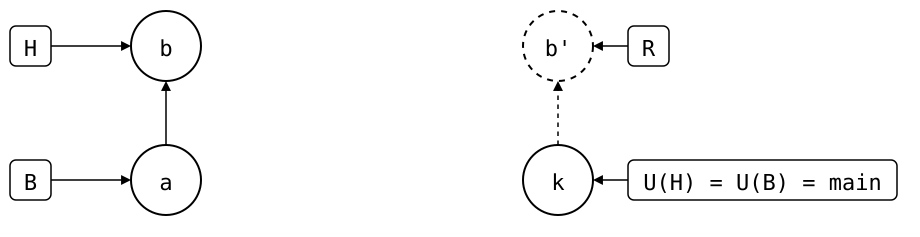

# Scenario: feature-branch-from-main

The monorepo's `main` has a commit that upstream's `main` lacks, and the
monorepo is on a branch cut from it. Upstream protects its `main`, say, so
changes only go in through a PR from another branch.

<div align="center">



</div>

- **Upstream**: only `main`, at *k* (`seed`).
- **Monorepo (`vendor/a/`)**: *a* (`add vendor/a`) cloned *k* on `main`, then
  a local commit *b* (`local change`), then the branch `feature` without
  further changes.

Upstream has no `feature` branch, so there's no T. The splice didn't
change on `feature`, but `feature` has *b*, which upstream's `main` lacks:
R's copy *b'* is dashed, no upstream branch has it yet. That's what counts, as for a PR: `push` creates
`feature` upstream with it, ready for one (#150).

## Output

<!--
```scrut {fail_fast: true, output_stream: combined}
$ source "$TESTDIR/../../../readme-setup.sh"
```
-->

[`setup.bash`](setup.bash) builds this state:

```scrut
$ build_scenario scenario_feature_branch_from_main
```

The drawing shows what Git and `git-splice` say about it, with each
commit named by its place in the history
([`check_drawing`](../../../../../check-drawing/)):

```scrut
$ check_drawing "$TESTDIR/feature-branch-from-main.drawio.svg" a=HEAD~1 b=HEAD k=refs/splices/upstream/main
ok   feature-branch-from-main.drawio.svg: 4 commits, 6 arrows, 4 boxes, 0 frames, 1 lanes
```

```scrut
$ git splice status
On branch feature

  new, ahead 1  vendor/a  push creates the branch
```

```scrut
$ git splice log
===  vendor/a (upstream has no 'feature' branch -- compared with 'main')
< e859a6b local change  (Test <test@example.com>)
```

```scrut
$ git splice diff --stat
===  vendor/a
 file.txt | 1 +
 1 file changed, 1 insertion(+)
```

```scrut
$ git splice push vendor/a
??   vendor/a: upstream has no 'feature' branch yet -- this push creates it
ok   vendor/a: pushed e859a6b to feature
```

```scrut
$ git splice status
On branch feature

  up to date  vendor/a
```
