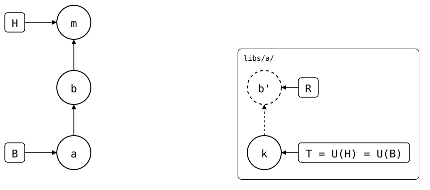

# Scenario: moved-with-unpushed-commits

A splice with an unpushed commit is moved with `git mv`. The next push
sends the right content, but squashes the unpushed commit into the move:
its message and author are lost. This is a known bug,
[#4](https://github.com/roschaefer/git-splice/issues/4).

- **Monorepo (`vendor/a/`)**: *a* (`add vendor/a`) cloned *k* (`seed`),
  then a local commit *b* (`local change`), not pushed yet.
- **Upstream**: *k*.

<div align="center">



</div>

`push` rebuilds the commits that changed the splice's folder. It looks for
them under the folder's current path only, so it doesn't see the commits
made under the old one, and the move commit *m* (`reorganize folders`)
appears to create the whole folder. *m* added `libs/a/.splice`, so it's B,
and R is *m'*, a copy of *m* alone: *b* has none.

Workaround: push before moving a splice, as
[shown here](push-before-moving.md).

## Output

<!--
```scrut {fail_fast: true, output_stream: combined}
$ source "$TESTDIR/../../../readme-setup.sh"
```
-->

[`setup.bash`](setup.bash) builds this state:

```scrut
$ build_scenario scenario_moved_with_unpushed_commits
```

Before the move, the local commit is waiting to be pushed:

```scrut
$ git splice log
===  vendor/a (main)
< e859a6b local change  (Test <test@example.com>)
```

Someone else reorganizes the folders:

```scrut
$ git mv vendor/a libs/a && git -c user.name=Mover -c user.email=mover@example.com commit -q -m "reorganize folders"
```

The splice's fetched refs stay under the old path
([#21](https://github.com/roschaefer/git-splice/issues/21)), so fetch
under the new one first:

```scrut
$ git splice fetch libs/a
ok   libs/a fetched
```

The drawing shows what Git and `git-splice` say about it now
([`check_drawing`](../../../../../check-drawing/)):

```scrut
$ check_drawing "$TESTDIR/moved-with-unpushed-commits.drawio.svg" a=HEAD~2 b=HEAD~1 m=HEAD k=refs/splices/upstream/main
ok   moved-with-unpushed-commits.drawio.svg: 5 commits, 6 arrows, 3 boxes, 1 lanes
```

Now the move is the only commit to push. The local commit is gone from the
list:

```scrut
$ git splice log
===  libs/a (main)
< a9da2f2 reorganize folders  (Mover <mover@example.com>)
```

The push sends the right content, as one commit with the move's message
and author:

```scrut
$ git splice push libs/a
ok   libs/a: pushed a9da2f2 to main
```

```scrut
$ git -C "$UPSTREAM" log --format='%s  (%an)' main
reorganize folders  (Mover)
seed  (Test)
```

```scrut
$ git -C "$UPSTREAM" show --format= main
diff --git a/file.txt b/file.txt
index e31de1f..d939bfa 100644
--- a/file.txt
+++ b/file.txt
@@ -1 +1,2 @@
 seed
+local change
```
