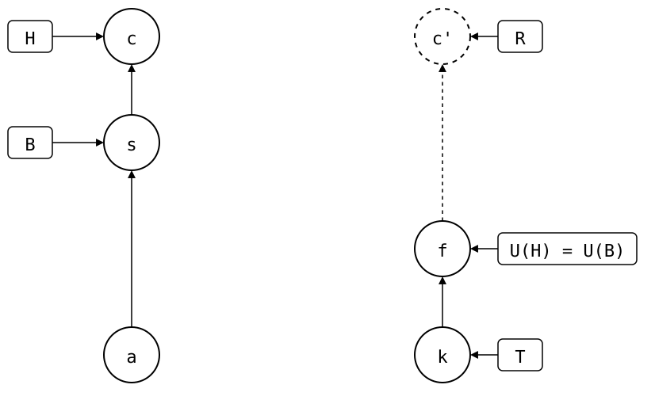

# Scenario: squash-merged-pull

A pull on a feature branch, squash-merged into `main`.

<div align="center">



</div>

- **Upstream**: *k* (`seed`) on `main`, and someone else's commit *f*
  (`upstream feature work`) on `feature`.
- **Monorepo (`vendor/a/`)**: *a* (`add vendor/a`) cloned *k*. On `feature`,
  `git splice pull` brought in *f*. `feature` was squash-merged into `main`
  as *s* and deleted, then a local commit *c* followed on `main`.

`.splice` records a commit, not a branch: *s* records *f* as U(H). The
upstream's `main`, T, is still at *k*, since nobody merged `feature` into
it there. *f* is on the upstream's `feature`, so it's solid. R's copy *c'*
is dashed: no upstream branch has it yet.

A squash merge keeps the content and drops the history. With `git subtree`,
that lost the sync point. Here *s* itself changed `.splice`, so it is B, and
the rebuild starts at *f*: R is *c'*, the copy of *c*, on top of *f*.

## Output

<!--
```scrut {fail_fast: true, output_stream: combined}
$ source "$TESTDIR/../../readme-setup.sh"
```
-->

[`setup.bash`](setup.bash) builds this state:

```scrut
$ build_scenario scenario_squash_merged_pull
```

The drawing shows what Git and `git-splice` say about it, with each
commit named by its place in the history
([`check_drawing`](../../../../check-drawing/)):

```scrut
$ check_drawing "$TESTDIR/squash-merged-pull.drawio.svg" a=HEAD~2 s=HEAD~1 c=HEAD k=refs/splices/upstream/main f=refs/splices/upstream/feature
ok   squash-merged-pull.drawio.svg: 6 commits, 9 arrows, 5 boxes, 0 frames, 1 lanes
```

```scrut
$ git log --format=%s
local change
feature (squash-merged)
add vendor/a
initial commit
```

```scrut
$ git splice status
On branch main

  ahead 2  vendor/a
```

```scrut
$ git splice log
===  vendor/a (main)
< 5c5de89 local change  (Test <test@example.com>)
< 223f9b4 upstream feature work  (Test <test@example.com>)
```

```scrut
$ git splice push vendor/a
ok   vendor/a: pushed 5c5de89 to main
```

```scrut
$ git -C "$UPSTREAM" log --format=%s main
local change
upstream feature work
seed
```
