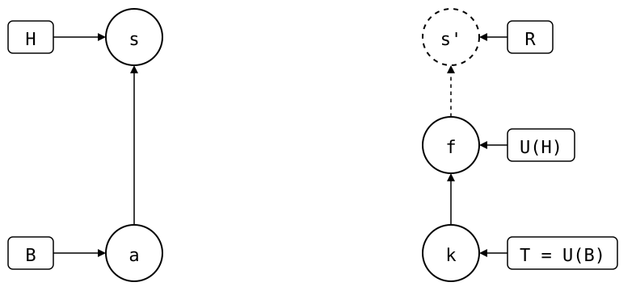

# Scenario: local-edit-in-the-squash

The [parent scenario's](../README.md) squash merge, but the feature
branch also edited the folder. So one commit, s, does two things: it
records the pulled upstream commit f in `.splice`, and it holds a local
edit that the upstream doesn't have.

<div align="center">



</div>

- **Upstream**: as in the parent scenario, k (`seed`) on `main`, and
  someone else's commit f (`upstream feature work`) on `feature`.
- **Monorepo (`vendor/a/`)**: a (`add vendor/a`) cloned k. On `feature`,
  `git splice pull` brought in f, then a commit added `local.txt`.
  `feature` was squash-merged into `main` as s, and deleted.

`.splice` records a commit, not a branch: s records f as U(H). The
upstream's `main`, T, is still at k, since nobody merged `feature` into
it there. T lacks f and R's copy s', so they're dashed.

## Output

<!--
```scrut {fail_fast: true, output_stream: combined}
$ source "$TESTDIR/../../../readme-setup.sh"
```
-->

[`setup.bash`](setup.bash) builds this state:

```scrut
$ build_scenario scenario_local_edit_in_the_squash
```

The drawing shows what Git and `git-splice` say about it, with each
commit named by its place in the history
([`check_drawing`](../../../../helpers/drawing.bash)):

```scrut
$ check_drawing "$TESTDIR/local-edit-in-the-squash.drawio.svg" a=HEAD~1 s=HEAD k=refs/splices/upstream/main f=refs/splices/upstream/feature
ok   local-edit-in-the-squash.drawio.svg: 5 commits, 8 arrows, 5 boxes, 0 frames
```

s is the last commit, and the only one since the clone a:

```scrut
$ git log --format=%s
feature (squash-merged)
add vendor/a
initial commit
```

### What the squash merge records, and what it holds

s's `.splice` records f, U(H):

```scrut
$ git -C "$UPSTREAM" log -1 --format=%s "$(git config --file vendor/a/.splice splice.commit)"
upstream feature work
```

But its folder isn't f: it has the local edit too.

```scrut
$ git diff --name-only "$(git config --file vendor/a/.splice splice.commit)" HEAD:vendor/a -- ':!.splice'
local.txt
```

### Where the rebuild starts

So s can't be B, the newest commit that changed
`.splice` and whose folder is the commit it recorded
([sync model](../../../../concepts/sync-model/README.md)). The rebuild
copies s, and starts where it would have before s, at the clone, a:

```scrut
$ git log -1 --format=%s "$(git splice boundary vendor/a)"
add vendor/a
```

The rebuild copies the commits after B:

```scrut
$ git log --format=%s "$(git splice boundary vendor/a)..HEAD" -- vendor/a
feature (squash-merged)
```

R is that copy, s', on top of f:

```scrut
$ git log --format=%s "$(git splice rebuild vendor/a)"
feature (squash-merged)
upstream feature work
seed
```

Before, B was s itself, because its `.splice` changed.
Then `git log B..HEAD` was empty, while a push still sent the local edit.

### Push

The upstream's `main` gets both: f, and s' with the local edit, under
s's message.

```scrut
$ git splice push vendor/a
ok   vendor/a: pushed 0461d52 to main
```

```scrut
$ git -C "$UPSTREAM" log --format=%s main
feature (squash-merged)
upstream feature work
seed
```
