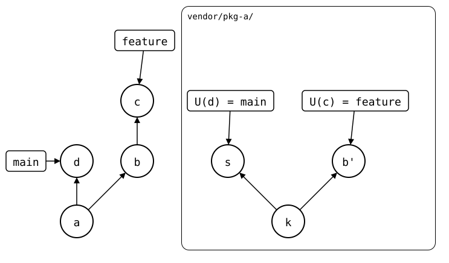
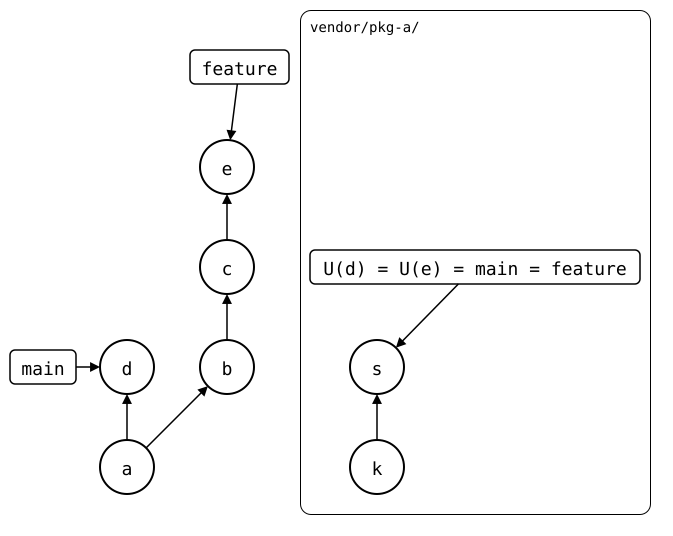

# Bumping the sync point

A push [never writes to the monorepo](../concepts/sync-model/README.md#why-a-push-isnt-recorded),
so after one, `.splice` still names the upstream commit from before it.
`git splice pull --bump` records the upstream branch anyway, in a
commit that only changes `.splice`, like a submodule bump. Later rebuilds then start at the pushed commit, instead
of rebuilding every commit pushed since the last pull.

Don't bump too often. A bump only saves work: without it, a push still
sends only what isn't upstream yet. But each bump is one more commit
that changes `.splice`, and two branches that record different commits
there conflict when they're merged, even where the files would merge
cleanly.

Bump on `main`. If the library squash-merges its pull requests, a bump
on a feature branch makes `.splice` conflict when the branch is merged
after the library's. Merged before, it leaves `main`'s `.splice` naming
the pull request's commit, which the library may delete. This workflow
shows a bump on `main`, both cases on a feature branch, and how to get
out of the conflict.

<!-- Builds a fresh sandbox; see `just docs-check`.
```scrut {fail_fast: true, output_stream: combined}
$ source "$TESTDIR/scrut-setup.sh"
```
-->

## On main, after a push

Bring `pkg-a` up to date, as in the [main walkthrough](README.md#pull),
then change it and push:

```scrut
$ git splice pull vendor/pkg-a >/dev/null
```

```scrut
$ echo "a faster parser" >>vendor/pkg-a/file.txt &&
>   git commit -qam "pkg-a: a faster parser"
```

```scrut
$ git splice push vendor/pkg-a
ok   vendor/pkg-a: pushed 9816d9f to main
```

A pull right after the push has nothing to bring in, and leaves `.splice`
as it was:

```scrut
$ git splice pull vendor/pkg-a
ok   vendor/pkg-a fetched
ok   vendor/pkg-a: nothing to pull
```

```scrut
$ git log -1 --format=%s "$(git config --file vendor/pkg-a/.splice splice.commit)"
pkg-a: a second commit, after the clone
```

With `--bump`, it records the pushed commit:

```scrut
$ git splice pull --bump vendor/pkg-a
ok   vendor/pkg-a fetched
ok   vendor/pkg-a: bumped the synced commit to 9816d9f
```

```scrut
$ git log -1 --format=%s "$(git config --file vendor/pkg-a/.splice splice.commit)"
pkg-a: a faster parser
```

```scrut
$ git log -1 --format=%s
splice: bump vendor/pkg-a from main at 9816d9f
```

[bump-after-push](../scenarios/01-everyday-sync/02-up-to-date/02-push-ahead/01-pushed-then-pulled/bump-after-push.md)
shows what that changes for the rebuild.

## On a feature branch: a conflict

A feature that changes the library and the monorepo's code that uses it:

```scrut
$ git switch -q -c feature
```

```scrut
$ echo "an option" >>vendor/pkg-a/file.txt &&
>   mkdir -p app &&
>   echo "uses the option" >app/main.txt &&
>   git add app &&
>   git commit -qam "pkg-a: an option, and the app uses it"
```

The push creates `pkg-a`'s `feature` branch, the library's pull request.
A bump then records it on the monorepo's `feature`:

```scrut
$ git splice push vendor/pkg-a
??   vendor/pkg-a: upstream has no 'feature' branch yet -- this push creates it
ok   vendor/pkg-a: pushed 556e8b7 to feature
```

```scrut
$ git splice pull --bump vendor/pkg-a
ok   vendor/pkg-a fetched
ok   vendor/pkg-a: bumped the synced commit to 556e8b7
```

The library squash-merges the pull request: its `main` gets the same
change as a new commit. Here in a clone of `pkg-a`, as its maintainer
would:

```scrut
$ git clone -q "$WALKTHROUGH/upstream/pkg-a.git" "$WALKTHROUGH/pkg-a" &&
>   cd "$WALKTHROUGH/pkg-a" &&
>   git config user.name "Maintainer" &&
>   git config user.email "maintainer@example.com"
```

```scrut
$ git merge -q --squash origin/feature &&
>   git commit -q -m "an option (#1)" &&
>   git push -q origin main
Squash commit -- not updating HEAD
```

Back in the monorepo, `main` pulls it:

```scrut
$ cd "$WALKTHROUGH/monorepo" && git switch -q main
```

```scrut
$ git splice pull vendor/pkg-a
ok   vendor/pkg-a fetched (main moved 9816d9f..0d27eb0)
ok   vendor/pkg-a: pulled 0d27eb0
```

*a* is the bump on `main`, *b* the feature, pushed as *b'*, and *c* its
bump. *d* is `main`'s pull of *s* (`an option (#1)`), the library's
squashed commit, on top of *k* (`pkg-a: a faster parser`):

<div align="center">



</div>

<!--
```scrut
$ source "$TESTDIR/../../check-drawing/check-drawing" &&
>   check_drawing "$TESTDIR/bump-conflict.drawio.svg" \
>   a=main~1 d=main b=feature~1 c=feature \
>   k=splices/pkg-a/heads/main~1 s=splices/pkg-a/heads/main
ok   bump-conflict.drawio.svg: 7 commits, 9 arrows, 4 boxes, 1 lanes
```
-->

`main` has the library's change now, but not the app's. So the monorepo's
`feature` still needs merging, and that conflicts: *d*'s `.splice`
records *s*, and *c*'s the same line as *b'*. A squash merge computes its
files like any merge, so it conflicts too:

```scrut
$ git merge --squash feature
Auto-merging vendor/pkg-a/.splice
CONFLICT (content): Merge conflict in vendor/pkg-a/.splice
Squash commit -- not updating HEAD
Automatic merge failed; fix conflicts and then commit the result.
[1]
```

```scrut
$ git reset -q --hard
```

Without the bump, `feature` wouldn't have changed `.splice`, and the merge
would take `main`'s.

## The way out: rebase the library's branch

Rebase the library's `feature` onto its `main`. The squashed commit
already has the change, so the rebase drops it, and `feature` becomes the
library's `main`:

```scrut
$ cd "$WALKTHROUGH/pkg-a" &&
>   git switch -q feature &&
>   git -c advice.skippedCherryPicks=false rebase -q main &&
>   git push -q -f origin feature
```

```scrut
$ git log -1 --format=%s feature
an option (#1)
```

The monorepo's `feature` pulls it. The folder already has its files, so
`pull` records it, without the need for `--bump`:

```scrut
$ cd "$WALKTHROUGH/monorepo" && git switch -q feature
```

```scrut
$ git splice pull vendor/pkg-a
ok   vendor/pkg-a fetched (feature moved 556e8b7..0d27eb0)
ok   vendor/pkg-a: recorded 0d27eb0 as the synced commit -- the folder already has its files
```

The record *e* names *s*, as `main`'s *d* does:

<div align="center">



</div>

<!--
```scrut
$ source "$TESTDIR/../../check-drawing/check-drawing" &&
>   check_drawing "$TESTDIR/bump-way-out.drawio.svg" \
>   a=main~1 d=main b=feature~2 c=feature~1 e=feature \
>   k=splices/pkg-a/heads/main~1 s=splices/pkg-a/heads/main
ok   bump-way-out.drawio.svg: 7 commits, 8 arrows, 3 boxes, 1 lanes
```
-->

Now both branches name the same commit in `.splice`, and the merge only
brings in the app:

```scrut
$ git switch -q main && git merge --squash feature
Automatic merge went well; stopped before committing as requested
Squash commit -- not updating HEAD
```

```scrut
$ git status --short
A  app/main.txt
```

```scrut
$ git commit -q -m "app: use pkg-a's option" && git splice status
On branch main

  up to date  vendor/pkg-a
```

If the library deleted its `feature` branch after the merge, there's
nothing to pull. Merge `main` into the monorepo's `feature` instead, and
resolve `.splice` to `main`'s version.

## Merged first: a commit that disappears

Another feature, with a bump on its branch. This time, `main` merges it
before the library merges its pull request:

```scrut
$ git switch -q -c feature-2 &&
>   echo "a second option" >>vendor/pkg-a/file.txt &&
>   git commit -qam "pkg-a: a second option"
```

```scrut
$ git splice push vendor/pkg-a >/dev/null && git splice pull --bump vendor/pkg-a
ok   vendor/pkg-a fetched
ok   vendor/pkg-a: bumped the synced commit to f7e1048
```

```scrut
$ git switch -q main && git merge -q --no-ff -m "Merge branch 'feature-2'" feature-2
```

`main`'s `.splice` now names a commit of the library's `feature-2`:

```scrut
$ git log -1 --format=%s "$(git config --file vendor/pkg-a/.splice splice.commit)"
pkg-a: a second option
```

The library squash-merges the pull request and deletes its branch, as
many hosts do:

```scrut
$ cd "$WALKTHROUGH/pkg-a" &&
>   git fetch -q &&
>   git switch -q main &&
>   git merge -q --squash origin/feature-2 &&
>   git commit -q -m "a second option (#2)" &&
>   git push -q origin main :feature-2
Squash commit -- not updating HEAD
```

Then it goes on with a change of its own:

```scrut
$ echo "a third option" >>file.txt &&
>   git commit -qam "a third option" &&
>   git push -q origin main
```

Nothing refers to the pull request's commit any more, and the library's
`gc` removes it:

```scrut
$ git -C "$WALKTHROUGH/upstream/pkg-a.git" gc -q --prune=now &&
>   synced="$(git -C "$WALKTHROUGH/monorepo" config --file vendor/pkg-a/.splice splice.commit)" &&
>   git -C "$WALKTHROUGH/upstream/pkg-a.git" cat-file -t "$synced"
fatal: git cat-file: could not get object info
[128]
```

The monorepo that bumped still has the commit, but a fresh clone of it
can't fetch it:

```scrut
$ cd "$WALKTHROUGH" &&
>   git clone -q \
>     --config "url.$WALKTHROUGH/upstream/.insteadOf=https://git.example.com/" \
>     "file://$WALKTHROUGH/monorepo" colleague &&
>   cd colleague
```

```scrut
$ git splice fetch vendor/pkg-a
ok   vendor/pkg-a fetched
```

```scrut
$ git splice status vendor/pkg-a
On branch main

  !! unrelated history  vendor/pkg-a  see 'git splice merge vendor/pkg-a' for options
```

Without the bump, `main`'s `.splice` would name a commit on the
library's `main`, which it keeps, and a pull would bring in
`a third option`.

## A company fork

The rebase needs a library branch you can force-push. For a library you
don't maintain, that's a branch in your company's fork of it: push the
feature there, open the pull request from the fork, and rebase the fork's
branch once the original squash-merged it
([contributing through a fork](fork.md)).
