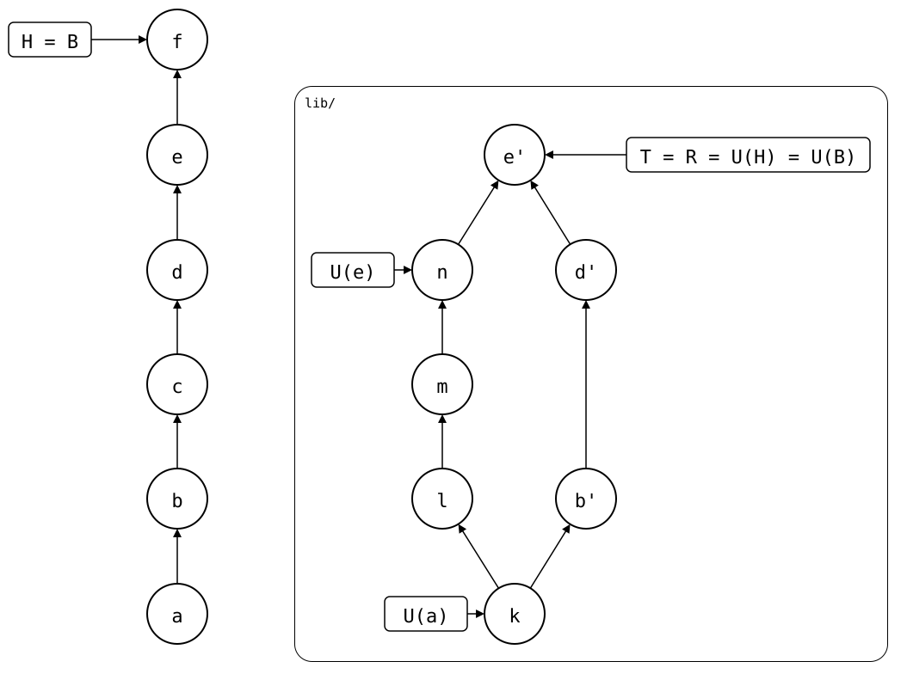
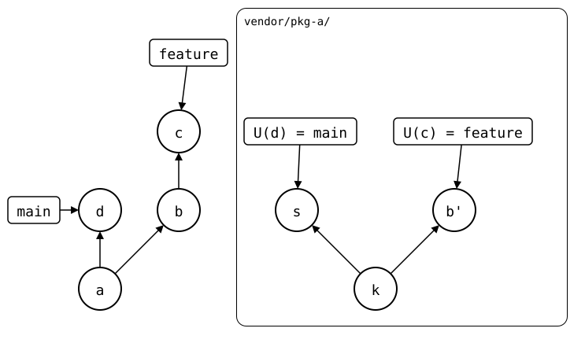

# Bumping the sync point

After a push, the upstream has your commits, but the monorepo's `.splice`
still names the upstream commit from before: a push
[never writes to the monorepo](../../concepts/sync-model/README.md#r-is-computed-not-stored).
Nothing breaks, since the next push still sends only what isn't upstream
yet. `git splice pull --bump` records the pushed commit anyway, in a
commit that only changes `.splice`, much like a submodule bump:

<div align="center">



</div>

## When a bump pays off

| Without a bump | Read more |
|---|---|
| Every rebuild starts at the last pull, and copies the pushed commits again. | [bump after the push](../../scenarios/01-everyday-sync/02-up-to-date/02-push-ahead/01-pushed-then-pulled/bump-after-push.md) |
| The synced commits of the pulls before and after the push span the pushed commits, which misleads a bisect between them. | [bisect into a pull](../../scenarios/03-branches-and-teamwork/05-bisect-into-a-pull/01-after-a-push/README.md) |
| A new id for the splice starts its history before the push, so the pushed change comes again, and the next push is refused. | [a new id after the push](../../scenarios/01-everyday-sync/02-up-to-date/02-push-ahead/01-pushed-then-pulled/new-id-after-push.md) |

<!-- Builds a fresh sandbox; see `just docs-check`.
```scrut {fail_fast: true, output_stream: combined}
$ source "$TESTDIR/../scrut-setup.sh"
```
-->

## Bump on main, after a push

Bring `pkg-a` up to date, as in the [main walkthrough](../README.md#pull),
then change it and push:

```scrut
$ git splice pull vendor/pkg-a >/dev/null &&
>   echo "a faster parser" >>vendor/pkg-a/file.txt &&
>   git commit -qam "k: a faster parser"
```

```scrut
$ git splice push vendor/pkg-a
ok   vendor/pkg-a: pushed dd60ba4 to main
```

A plain pull would find nothing to pull. With `--bump`, it records the
pushed commit:

```scrut
$ git splice pull --bump -m "a: bump pkg-a to the faster parser" vendor/pkg-a
ok   vendor/pkg-a fetched
ok   vendor/pkg-a: bumped the synced commit to dd60ba4
```

```scrut
$ git log -1 --format=%s "$(git config --file vendor/pkg-a/.splice splice.commit)"
k: a faster parser
```

## Not on a feature branch

Two branches that record different commits in `.splice` conflict when
they're merged, even where the files would merge cleanly. Without a bump,
a feature branch leaves `.splice` alone, and a merge takes `main`'s. So
when the library squash-merges its pull requests, a bump on the
monorepo's `feature` causes trouble either way:

| The monorepo merges `feature`… | Then | Way out |
|---|---|---|
| after the library squash-merged | `.splice` conflicts: `main` names the squashed *s*, `feature` the pull request's *b'*. | Rebase the library's `feature` onto its `main`, then pull on `feature`. |
| before the library squash-merged | `main`'s `.splice` names the pull request's commit. Once the library deletes the branch, a fresh clone can't fetch it. | Don't bump on `feature`. |

<div align="center">



</div>

The rebase needs a library branch you can force-push. For a library you
don't maintain, that's a branch in your company's fork of it
([contributing through a fork](../fork.md)).
[On a feature branch](on-a-feature-branch.md) runs both cases and the
way out.
