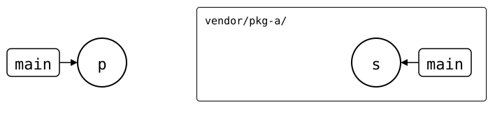
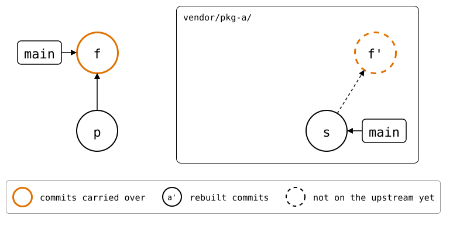
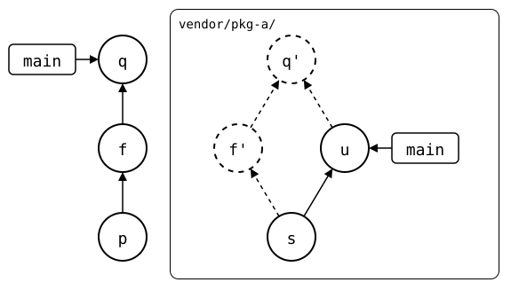
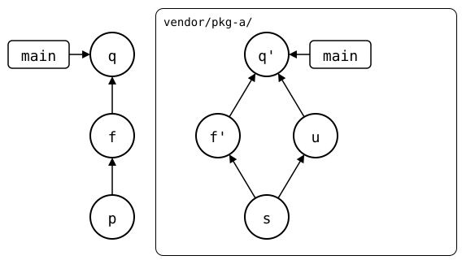

# Diverged history

A splice has diverged when both the monorepo and the upstream changed it
since the last sync. In this example, both sides change the same line, then
resolve the conflict. It uses the [walkthrough sandbox](README.md).

<!-- Builds a fresh sandbox; see `just docs-check`.
```scrut {fail_fast: true, output_stream: combined}
$ source "$TESTDIR/scrut-setup.sh"
```

```scrut
$ git clone -q "$WALKTHROUGH/upstream/pkg-a.git" ../pkg-a-s &&
>   git -C ../pkg-a-s commit --amend -qm "s: pkg-a second commit" &&
>   git -C ../pkg-a-s push --force -q
```
-->

First, bring `vendor/pkg-a/` up to date:

```scrut
$ git splice pull -m "p: pull pkg-a" vendor/pkg-a
ok   vendor/pkg-a fetched (main moved 703b936..53e5f5f)
ok   vendor/pkg-a: pulled 53e5f5f
```

<div align="center">



</div>

<!--
```scrut
$ source "$TESTDIR/../../check-drawing/check-drawing" && \
>   check_drawing "$TESTDIR/diverged-up-to-date.drawio.svg" p=HEAD
ok   diverged-up-to-date.drawio.svg: 2 commits, 2 arrows, 2 boxes, 1 lanes
```
-->

## Both sides change

The monorepo changes `vendor/pkg-a/`:

```scrut
$ echo "a local fix" >>vendor/pkg-a/file.txt && git commit -qam "f: a local fix"
```

<div align="center">



</div>

<!--
```scrut
$ check_drawing "$TESTDIR/diverged-local-change.drawio.svg" \
>   p=HEAD~1 f=HEAD
ok   diverged-local-change.drawio.svg: 4 commits, 4 arrows, 2 boxes, 1 lanes
```
-->

The upstream also gets a new commit, changing the same file:

```scrut
$ git clone -q "$WALKTHROUGH/upstream/pkg-a.git" ../pkg-a &&
>   echo "pkg-a: an upstream fix" >>../pkg-a/file.txt &&
>   git -C ../pkg-a commit -qam "u: an upstream fix" &&
>   git -C ../pkg-a push -q
```

Fetch it into the monorepo:

```scrut
$ git splice fetch
ok   vendor/pkg-a fetched (main moved 53e5f5f..bc52052)
```

<div align="center">


</div>

<!--
```scrut
$ check_drawing "$TESTDIR/diverged.drawio.svg"
ok   diverged.drawio.svg: 5 commits, 5 arrows, 2 boxes, 1 lanes
```
-->

`status` now reports the splice as diverged, and `log` shows both sides:

```scrut
$ git splice status
On branch main

  ahead 1, behind 1  vendor/pkg-a
```

```scrut
$ git splice log
===  vendor/pkg-a (main)
< 4bb4822 f: a local fix  (Walkthrough <walkthrough@example.com>)
> bc52052 u: an upstream fix  (Walkthrough <walkthrough@example.com>)
```

`git splice log --graph` draws both sides:

```scrut
$ git splice log --graph
===  vendor/pkg-a (main)
< 4bb4822 (R) f: a local fix  (Walkthrough <walkthrough@example.com>)
| > bc52052 (T) u: an upstream fix  (Walkthrough <walkthrough@example.com>)
|/  
o 53e5f5f s: pkg-a second commit  (Walkthrough <walkthrough@example.com>)
```

## Pull first

`push` refuses to drop upstream's commit:

```scrut
$ git splice push vendor/pkg-a
!!   vendor/pkg-a: upstream has commits this branch lacks
!!   Failed: vendor/pkg-a
[1]
```

`pull` splices upstream's side in. The same line changed on both sides, so
it stops with a conflict, like any merge:

```scrut
$ git splice pull vendor/pkg-a
ok   vendor/pkg-a fetched
Auto-merging vendor/pkg-a/file.txt
CONFLICT (content): Merge conflict in vendor/pkg-a/file.txt
!!   vendor/pkg-a: conflict -- resolve it, then 'git commit' (or 'git cherry-pick --abort' to give up)
!!   vendor/pkg-a: pull failed
!!   Failed: vendor/pkg-a
[1]
```

```scrut
$ cat vendor/pkg-a/file.txt
pkg-a: seed
pkg-a: a second commit, after the clone
<<<<<<< HEAD
a local fix
=======
pkg-a: an upstream fix
>>>>>>> 40b5011 (splice: pull vendor/pkg-a from main at bc52052)
```

## Resolve and push

Resolve it as for any merge: keep both lines, then commit.

```scrut
$ cat >vendor/pkg-a/file.txt <<'EOF'
> pkg-a: seed
> pkg-a: a second commit, after the clone
> a local fix
> pkg-a: an upstream fix
> EOF
```

```scrut
$ git add vendor/pkg-a/file.txt && git commit -qm "q: pull pkg-a" && git log --oneline -1
16ab6ed q: pull pkg-a
```

The pull joins the rebuilt local fix with the upstream fix. The splice is
now ahead by two commits and ready to push:

<div align="center">



</div>

<!--
```scrut
$ check_drawing "$TESTDIR/diverged-after-pull.drawio.svg" \
>   p=HEAD~2 f=HEAD~1
ok   diverged-after-pull.drawio.svg: 7 commits, 8 arrows, 2 boxes, 1 lanes
```
-->

`git splice log --graph` draws the resolved history:

```scrut
$ git splice log --graph
===  vendor/pkg-a (main)
<   9624043 (R) q: pull pkg-a  (Walkthrough <walkthrough@example.com>)
|\  
< | 4bb4822 f: a local fix  (Walkthrough <walkthrough@example.com>)
| o bc52052 (T) u: an upstream fix  (Walkthrough <walkthrough@example.com>)
|/  
o 53e5f5f s: pkg-a second commit  (Walkthrough <walkthrough@example.com>)
```


```scrut
$ git splice status
On branch main

  ahead 2  vendor/pkg-a
```

Upstream gets the local fix as its own commit, joined with upstream's fix
by a merge:

```scrut
$ git splice push vendor/pkg-a
ok   vendor/pkg-a: pushed 9624043 to main
```

<div align="center">



</div>

<!--
```scrut
$ check_drawing "$TESTDIR/diverged-after-push.drawio.svg" \
>   p=HEAD~2 f=HEAD~1
ok   diverged-after-push.drawio.svg: 7 commits, 8 arrows, 2 boxes, 1 lanes
```
-->

```scrut
$ git -C "$WALKTHROUGH/upstream/pkg-a.git" log --graph --format=%s main
*   q: pull pkg-a
|\  
| * u: an upstream fix
* | f: a local fix
|/  
* s: pkg-a second commit
* pkg-a: seed
```

```scrut
$ git splice status
On branch main

  up to date  vendor/pkg-a
```
