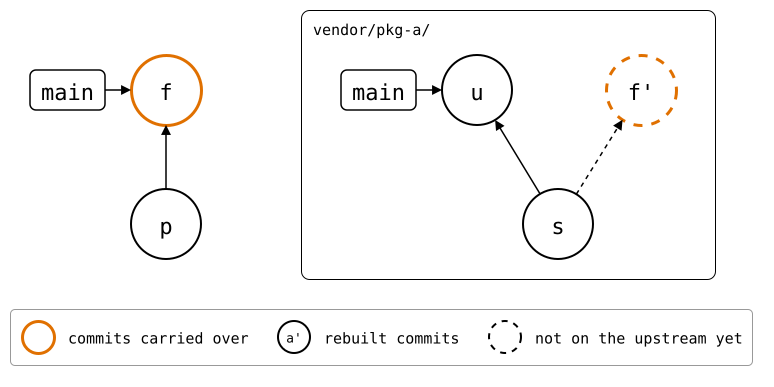

# Diverged history

A splice has diverged when both the monorepo and the upstream changed it
since the last sync. This walkthrough, in [its repositories](README.md), makes
both sides change the same line, then resolves the conflict.

<!-- Builds a fresh sandbox; see `just docs-check`.
```scrut {fail_fast: true, output_stream: combined}
$ source "$TESTDIR/scrut-setup.sh"
```
-->

First, bring `vendor/pkg-a/` up to date:

```scrut
$ git splice pull -m "p: pull pkg-a" vendor/pkg-a
ok   vendor/pkg-a fetched
ok   vendor/pkg-a: pulled 703b936
```

## Both sides change

The monorepo and the upstream each append a line to the same file:

```scrut
$ echo "a local fix" >>vendor/pkg-a/file.txt && git commit -qam "f: a local fix"
```

```scrut
$ git clone -q "$WALKTHROUGH/upstream/pkg-a.git" ../pkg-a &&
>   echo "pkg-a: an upstream fix" >>../pkg-a/file.txt &&
>   git -C ../pkg-a commit -qam "u: an upstream fix" &&
>   git -C ../pkg-a push -q
```

Once fetched, `status` reports the splice as `diverged`, and `log` shows
both sides:

```scrut
$ git splice fetch
ok   vendor/pkg-a fetched (main moved 703b936..5972aa1)
```

```scrut
$ git splice status
On branch main

  ahead 1, behind 1  vendor/pkg-a
```

```scrut
$ git splice log
===  vendor/pkg-a (main)
< c4dcfe0 f: a local fix  (Walkthrough <walkthrough@example.com>)
> 5972aa1 u: an upstream fix  (Walkthrough <walkthrough@example.com>)
```

In terms of the [four commits](../concepts/sync-model/README.md), R and T each
have a commit the other lacks, and U(H) is where they part:

<div align="center">



</div>

<!--
```scrut
$ source "$TESTDIR/../../check-drawing/check-drawing" && check_drawing "$TESTDIR/diverged.drawio.svg" s=refs/splices/pkg-a/heads/main~1
ok   diverged.drawio.svg: 5 commits, 8 arrows, 5 boxes, 1 lanes
```
-->

`log --graph` draws that right-hand side:

```scrut
$ git splice log --graph
===  vendor/pkg-a (main)
< c4dcfe0 (R) f: a local fix  (Walkthrough <walkthrough@example.com>)
| > 5972aa1 (T) u: an upstream fix  (Walkthrough <walkthrough@example.com>)
|/  
o 703b936 pkg-a: a second commit, after the clone  (Walkthrough <walkthrough@example.com>)
```

## Pull first

`push` refuses to drop upstream's commit:

```scrut
$ git splice push vendor/pkg-a
!!   vendor/pkg-a: upstream has commits this branch lacks -- run 'git splice pull vendor/pkg-a' first
!!   Failed: vendor/pkg-a
[1]
```

`pull` splices upstream's side in. The same line changed on both sides, so
it stops with a conflict, like any merge:

```scrut
$ git splice pull vendor/pkg-a
ok   vendor/pkg-a fetched
Auto-merging vendor/pkg-a/file.txt
CONFLICT (content): Merge conflict in vendor/pkg-a/file.txt
!!   vendor/pkg-a: conflict -- resolve it, then 'git commit' (or 'git cherry-pick --abort' to give up)
!!   vendor/pkg-a: pull failed
!!   Failed: vendor/pkg-a
[1]
```

```scrut
$ cat vendor/pkg-a/file.txt
pkg-a: seed
pkg-a: a second commit, after the clone
<<<<<<< HEAD
a local fix
=======
pkg-a: an upstream fix
>>>>>>> a3f4622 (splice: pull vendor/pkg-a from main at 5972aa1)
```

## Resolve and push

Resolve it as for any merge: keep both lines, then commit.

```scrut
$ cat >vendor/pkg-a/file.txt <<'EOF'
> pkg-a: seed
> pkg-a: a second commit, after the clone
> a local fix
> pkg-a: an upstream fix
> EOF
```

```scrut
$ git add vendor/pkg-a/file.txt && git commit -q --no-edit && git log --oneline -1
f428907 splice: pull vendor/pkg-a from main at 5972aa1
```

The resolved commit records T as the new U(H). Its folder is U(H) plus the
local fix, which was never pushed, so B stays the earlier pull, and R
joins the rebuilt local fix with U(H) by a merge, as a plain `git pull`
would have:

```text
      monorepo, newest first                 pkg-a.git, newest first

      = splice: pull vendor/pkg-a        R   <   splice: pull vendor/pkg-a from main at 4527a78
          (folder = U(H) + local fix)        |\
      * pkg-a: a local fix                   < | pkg-a: a local fix
  B   = splice: pull vendor/pkg-a     U(H) = T | * pkg-a: an upstream fix
                                             |/
                                             * pkg-a: a second commit, after the clone
```

T is an ancestor of R now, so the state is `push`, ahead by R's two `<`
commits. `log --graph` draws them down to the commits they build on, T
among them:

```scrut
$ git splice log --graph
===  vendor/pkg-a (main)
<   24f2ae6 (R) splice: pull vendor/pkg-a from main at 5972aa1  (Walkthrough <walkthrough@example.com>)
|\  
< | c4dcfe0 f: a local fix  (Walkthrough <walkthrough@example.com>)
| o 5972aa1 (T) u: an upstream fix  (Walkthrough <walkthrough@example.com>)
|/  
o 703b936 pkg-a: a second commit, after the clone  (Walkthrough <walkthrough@example.com>)
```


```scrut
$ git splice status
On branch main

  ahead 2  vendor/pkg-a
```

Upstream gets the local fix as its own commit, joined with upstream's fix
by a merge:

```scrut
$ git splice push vendor/pkg-a
ok   vendor/pkg-a: pushed 24f2ae6 to main
```

```scrut
$ git -C "$WALKTHROUGH/upstream/pkg-a.git" log --graph --format=%s main
*   splice: pull vendor/pkg-a from main at 5972aa1
|\  
| * u: an upstream fix
* | f: a local fix
|/  
* pkg-a: a second commit, after the clone
* pkg-a: seed
```

```scrut
$ git splice status
On branch main

  up to date  vendor/pkg-a
```

If the two sides share no history at all, e.g. because the upstream was
rebuilt from scratch, `merge`, `pull` and `push` don't try to merge. They
print the commands to keep either side instead; see the
[`diverged-unrelated-history`](../scenarios/06-rewritten-history/03-diverged-unrelated-history/README.md)
scenario.
