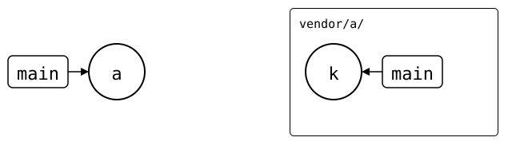
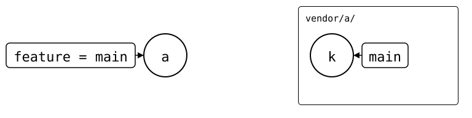
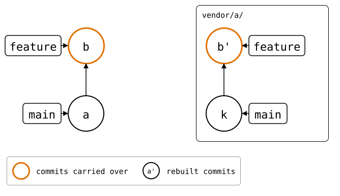

# Feature branches

By default, every splice follows the upstream branch named like the
monorepo's current branch.

If that branch does not exist upstream, `git-splice` compares the splice
with upstream's default branch instead. This works like a pull request or
merge request: the feature branch is compared with the default branch.

<div align="center">



</div>

This works across all the repositories involved. In the
[walkthrough sandbox](README.md), both splices start on `main`. Switch the
monorepo to `feature`; neither upstream has that branch:

<!-- Builds a fresh sandbox; see `just docs-check`.
```scrut {fail_fast: true, output_stream: combined}
$ source "$TESTDIR/scrut-setup.sh"
```

```scrut
$ git splice clone https://git.example.com/pkg-b.git vendor/pkg-b >/dev/null &&
>   git splice pull --all >/dev/null
```
-->

```scrut
$ git switch -c feature
Switched to a new branch 'feature'
```

<div align="center">



</div>

Both splices still match upstream `main`, so neither needs an upstream
branch of its own:

```scrut
$ git splice status
On branch feature

  unchanged, no upstream branch  vendor/pkg-a
  unchanged, no upstream branch  vendor/pkg-b
```

Change `pkg-b` on the feature branch:

```scrut
$ echo "a new option" >>vendor/pkg-b/file.txt &&
>   git commit -qam "pkg-b: add an option" &&
>   git splice status
On branch feature

  new, ahead 1                   vendor/pkg-b  push creates the branch

  unchanged, no upstream branch  vendor/pkg-a
```

The monorepo's `feature` branch has moved ahead of `main`. Rebuilding the
changed splice would put that change on top of upstream `main`:

<div align="center">


</div>

Pushing all splices creates `feature` only in `pkg-b`'s upstream:

```scrut
$ git splice push --all
ok   vendor/pkg-a: nothing to push (upstream has no 'feature' branch, and 'main' has every commit)
??   vendor/pkg-b: upstream has no 'feature' branch yet -- this push creates it
ok   vendor/pkg-b: pushed 5023101 to feature
```

<div align="center">



</div>

The monorepo's feature branch can therefore carry changes across several
repositories. Each upstream gets a matching feature branch only when it
needs one.
