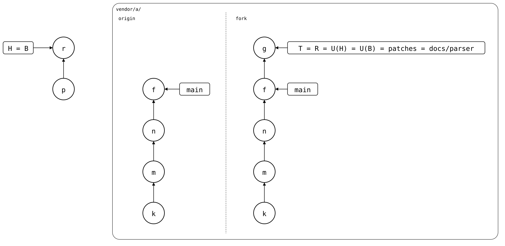

# Contributing through a fork

You fixed a library you don't maintain. It takes changes only as pull
requests, and may take weeks to merge yours. Your monorepo needs the fix
now. So keep the fix in a fork of the library, and let the monorepo
follow the fork until the library has taken it.

The fork has three kinds of branches:

- **`main`**: a copy of the library's `main`. Nobody commits on it.
- **`patches`**: your changes on top of `main`. The monorepo follows
  this branch, so it has every fix, merged upstream or not.
- **One branch per pull request**: each with one change on top of
  `main`, so the library can review and take each on its own. With a
  single change, `patches` can be the pull request's branch.

<div align="center">


</div>

Here the monorepo made two changes, *x* and *y*. In the fork, each has a
branch of its own, *q* on `fix/parser` and *e* on `docs/parser`, and
`patches` has both. A [scenario](../scenarios/04-upstreams/07-contributing-through-a-fork/README.md)
runs the whole workflow.

## Follow the fork

Fork the library on its host. Then add the fork to the splice's
`.splice` as a second [upstream](../concepts/upstreams/README.md), make
it the default, and follow its `patches`:

```sh
git config --file vendor/a/.splice upstream.fork.url 'https://github.com/<you>/lib.git'
git config --file vendor/a/.splice upstream.fork.default-branch patches
git config --file vendor/a/.splice splice.default-upstream fork
git commit -m "follow the fork's patches" -- vendor/a/.splice
```

```text
[splice]
	id = …
	commit = …
	default-upstream = fork
[upstream "origin"]
	url = https://github.com/<them>/lib.git
[upstream "fork"]
	url = https://github.com/<you>/lib.git
	default-branch = patches
```

From then on, `git splice push vendor/a` sends your changes to the
fork's `patches`, and `git splice pull vendor/a` brings that branch in.

## Open a pull request per change

In a clone of the fork, give each change a branch that starts at `main`,
and push it:

```sh
git switch -c fix/parser origin/main
git cherry-pick <the change's commit on patches>
git push origin fix/parser
```

Open the pull request against the library. One against the fork's own
`main` runs the library's CI on it first.

## When the library moves on

Bring the fork's `main` up to date. It has no commits of its own, so
that's a fast-forward. Then rebase `patches` and the pull request
branches onto it, and force-push them:

```sh
git fetch original
git push origin original/main:main
git rebase origin/main patches
git push --force-with-lease origin patches
```

Then pull in the monorepo, as always. When the library has taken one of
your pull requests, the rebase drops that change from `patches`, since
`main` has it now. The monorepo already has the change, so its pull
only records the new `patches`. Here the library took `fix/parser` as
*f*. `patches` is now just *g*, the documentation change, on top of *f*,
and the monorepo's *r* records it:

<div align="center">



</div>

If the maintainer changed your fix on the way, the rebase conflicts in
the fork. Keep the library's version, and the monorepo pulls that.

## Push before the fork rebases

Push your changes from the monorepo to `patches` before anyone rebases
it. Then the rebased `patches` has them, and a pull only brings in the
fork's version of what the monorepo already has
([patch-branch-rebased](../scenarios/06-rewritten-history/04-patch-branch-rebased/README.md)).
A change you didn't push in time needs
[`pull --rebase`](../scenarios/06-rewritten-history/04-patch-branch-rebased/01-unpushed-local-commit/README.md).

The pull knows where `patches` was before the rebase from the fetched
branch's reflog, like `git pull --rebase`. That reflog is local: a fresh
clone of the monorepo that first fetches after the rebase doesn't have
it, and its pull conflicts.

## In practice

This repository works this way with
[scrut](https://github.com/facebookincubator/scrut), its test runner:
`scrut/` is a splice that follows a fork,
[roschaefer/scrut](https://github.com/roschaefer/scrut). The fork's
[pull requests](https://github.com/roschaefer/scrut/pulls?q=is%3Apr)
show each change on its way back to Meta.
