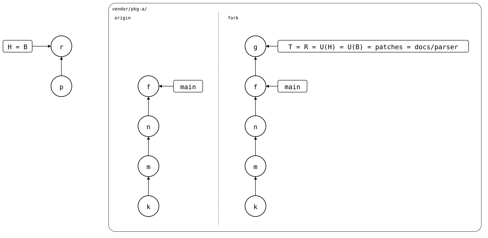

# Contributing through a fork

A library you don't maintain takes changes only as pull requests, and
may take its time with them. Meanwhile, the monorepo needs the changes
now. A fork of the library holds them in the meantime:

- **The fork's `main`** mirrors the original's `main`, and nothing else.
- **`patches`** holds the monorepo's changes on top of the fork's
  `main`. The monorepo's `main` follows it: the splice gets every
  change, including those the original hasn't taken yet.
- **One branch per change**, on top of the fork's `main`, once there
  are several changes the original should review one by one. Each
  becomes a pull request to the original, on its own, so it can be
  reviewed and taken on its own. A pull request against the fork's own
  `main` shows what's still to send, and runs the library's CI. With a
  single change, `patches` itself can be the pull request's branch.

When the original moves on, the fork's `main` catches up, and the
branches are rebased onto it. A change the original took drops out of
`patches` in that rebase.

This repository dogfoods the workflow with
[scrut](https://github.com/facebookincubator/scrut), its test runner:
`scrut/` is a splice that follows a fork of it,
[roschaefer/scrut](https://github.com/roschaefer/scrut). The fork's
[pull requests](https://github.com/roschaefer/scrut/pulls?q=is%3Apr)
show each change on its way back to Meta.

<!-- Builds a fresh sandbox; see `just docs-check`.
```scrut {fail_fast: true, output_stream: combined}
$ source "$TESTDIR/scrut-setup.sh"
```
-->

First, bring `pkg-a` up to date, as in the
[main walkthrough](README.md#pull):

```scrut
$ git splice pull vendor/pkg-a >/dev/null
```

## Fork the library

A host's "Fork" button copies the repository. Here, a bare clone next to
the original does:

```scrut
$ git clone -q --bare "$WALKTHROUGH/upstream/pkg-a.git" "$WALKTHROUGH/upstream/pkg-a-fork.git"
```

The splice gets the fork as a second upstream, and uses it by default.
Its `default-branch` makes the monorepo's `main` follow `patches`
instead of the fork's `main`
([upstreams](../concepts/upstreams/README.md)):

```scrut
$ git config --file vendor/pkg-a/.splice upstream.fork.url https://git.example.com/pkg-a-fork.git &&
>   git config --file vendor/pkg-a/.splice upstream.fork.default-branch patches &&
>   git config --file vendor/pkg-a/.splice splice.default-upstream fork &&
>   git commit -q -m "pkg-a: follow the fork's patches" -- vendor/pkg-a/.splice
```

```scrut
$ git config --file vendor/pkg-a/.splice --list | grep -v '^splice\.id='
splice.commit=703b9360f7ac335a1134e9b5771a90a7c09ba39a
splice.default-upstream=fork
upstream.origin.url=https://git.example.com/pkg-a.git
upstream.fork.url=https://git.example.com/pkg-a-fork.git
upstream.fork.default-branch=patches
```

## Changes in the monorepo

The monorepo fixes the library where it uses it, and documents the fix:

```scrut
$ echo "a parser fix" >>vendor/pkg-a/file.txt &&
>   git commit -qam "pkg-a: fix the parser"
```

```scrut
$ echo "how the parser works" >vendor/pkg-a/parser.md &&
>   git add vendor/pkg-a/parser.md &&
>   git commit -q -m "pkg-a: document the parser"
```

The fork has no `patches` yet, so the first push creates it:

```scrut
$ git splice push vendor/pkg-a
??   vendor/pkg-a: upstream has no 'fork/patches' branch yet -- this push creates it
ok   vendor/pkg-a: pushed 0091412 to fork/patches
```

## One branch per change

The two changes are independent, and the original should review them one
by one, so each pull request to the original gets a branch of its own,
with only its change on the fork's `main`. In a clone of the fork, with
the original as a second remote:

```scrut
$ git clone -q "$WALKTHROUGH/upstream/pkg-a-fork.git" "$WALKTHROUGH/pkg-a-fork" &&
>   cd "$WALKTHROUGH/pkg-a-fork" &&
>   git remote add original "$WALKTHROUGH/upstream/pkg-a.git"
```

```scrut
$ git switch -q -c fix/parser origin/main &&
>   git cherry-pick origin/patches~1
[fix/parser 7edd872] pkg-a: fix the parser
 Date: Thu Jan 1 00:00:00 2026 +0000
 1 file changed, 1 insertion(+)
```

```scrut
$ git switch -q -c docs/parser origin/main &&
>   git cherry-pick origin/patches
[docs/parser 16d516f] pkg-a: document the parser
 Date: Thu Jan 1 00:00:00 2026 +0000
 1 file changed, 1 insertion(+)
 create mode 100644 parser.md
```

```scrut
$ git push -q origin fix/parser docs/parser
```

```scrut
$ git log --format=%s origin/main..docs/parser
pkg-a: document the parser
```

From each branch, open a pull request against the fork's `main` to run
the library's CI, and one against the original. A change that needs
another one carries that one's commit too, and its pull request waits
for the other's.

## The original moves on

The original's maintainer commits something else:

```scrut
$ git clone -q "$WALKTHROUGH/upstream/pkg-a.git" "$WALKTHROUGH/pkg-a" &&
>   cd "$WALKTHROUGH/pkg-a" &&
>   git config user.name "Maintainer" &&
>   git config user.email "maintainer@example.com"
```

```scrut
$ echo "a new feature" >feature.txt &&
>   git add feature.txt &&
>   git commit -q -m "add a feature" &&
>   git push -q origin main
```

The fork's `main` catches up. It never has commits of its own, so that's
a fast-forward:

```scrut
$ cd "$WALKTHROUGH/pkg-a-fork" &&
>   git fetch -q original &&
>   git push -q origin original/main:main
```

Then the branches are rebased onto it and force-pushed, each with a
lease on where it was:

```scrut
$ git fetch -q origin &&
>   git rebase -q origin/main fix/parser &&
>   git rebase -q origin/main docs/parser &&
>   git switch -q -c patches origin/patches &&
>   git rebase -q origin/main &&
>   git push -q --force-with-lease origin fix/parser docs/parser patches
```

```scrut
$ git log --format=%s origin/patches
pkg-a: document the parser
pkg-a: fix the parser
add a feature
pkg-a: a second commit, after the clone
pkg-a: seed
```

The monorepo pulls the rebased `patches`. The commit it synced last is
still in its history, so this is an ordinary pull:

```scrut
$ cd "$WALKTHROUGH/monorepo" && git splice pull vendor/pkg-a
ok   vendor/pkg-a fetched from fork (patches moved 0091412..9cf4aab)
ok   vendor/pkg-a: pulled 9cf4aab
```

```scrut
$ git splice status
On branch main

  up to date  vendor/pkg-a -> fork/patches
```

`pull` fetched the fork only. `fetch` fetches both upstreams:

```scrut
$ git splice fetch vendor/pkg-a
ok   vendor/pkg-a fetched from origin (main moved 703b936..a4c229c)
ok   vendor/pkg-a fetched from fork
```

The splice's two upstreams side by side. The original, `origin`, has
*k* (`pkg-a: seed`), *m* (`pkg-a: a second commit, after the clone`)
and *n* (`add a feature`) on `main`. The fork has the same `main`, and
on top of it a branch for each pull request: *q* (`pkg-a: fix the
parser`) on `fix/parser`, and *e* (`pkg-a: document the parser`) on
`docs/parser`. `patches` stacks both, with *d*, the same change as *e*,
on top of *q*. The monorepo made the changes as *x* and *y*, and *p*
pulled *d*:

<div align="center">


</div>

<!--
```scrut
$ source "$TESTDIR/../../check-drawing/check-drawing" &&
>   check_drawing "$TESTDIR/fork.drawio.svg" \
>     x=HEAD~2 y=HEAD~1 p=HEAD \
>     k=refs/splices/pkg-a/heads/main~2 m=refs/splices/pkg-a/heads/main~1 n=refs/splices/pkg-a/heads/main \
>     q=refs/splices/pkg-a-fork/heads/fix/parser e=refs/splices/pkg-a-fork/heads/docs/parser \
>     d=refs/splices/pkg-a-fork/heads/patches
ok   fork.drawio.svg: 12 commits, 15 arrows, 6 boxes, 1 lanes, 2 upstreams
```
-->

## The original merges a pull request

The original takes `fix/parser`, but not `docs/parser` yet.

### In the original

The maintainer merges the pull request as a new commit on `main`: same
change, new message, new parent, as a squash merge would.

```scrut
$ cd "$WALKTHROUGH/pkg-a" &&
>   git fetch -q "$WALKTHROUGH/upstream/pkg-a-fork.git" fix/parser &&
>   git cherry-pick --no-commit FETCH_HEAD &&
>   git commit -q -m "Fix the parser (#1)" &&
>   git push -q origin main
```

### In the fork

The fork's `main` catches up again, and `docs/parser` and `patches`
are rebased onto it. This time, the rebase finds the fix already on
`main` and drops it from `patches`, which keeps only the documentation
on top. `fix/parser` has done its job, and goes:

```scrut
$ cd "$WALKTHROUGH/pkg-a-fork" &&
>   git fetch -q original &&
>   git push -q origin original/main:main &&
>   git fetch -q origin &&
>   git rebase -q origin/main docs/parser &&
>   git -c advice.skippedCherryPicks=false rebase -q origin/main patches &&
>   git push -q --force-with-lease origin docs/parser patches :fix/parser
```

```scrut
$ git log --format=%s origin/patches
pkg-a: document the parser
Fix the parser (#1)
add a feature
pkg-a: a second commit, after the clone
pkg-a: seed
```

### In the monorepo

The rebase rewrote the monorepo's last synced commit, *d*, away. But
the folder already has the files of the new `patches`, so the pull only
records it:

```scrut
$ cd "$WALKTHROUGH/monorepo" && git splice pull vendor/pkg-a
ok   vendor/pkg-a fetched from fork (patches moved 9cf4aab..267e5d5)
ok   vendor/pkg-a: recorded 267e5d5 as the synced commit -- the folder already has its files
```

```scrut
$ git splice status
On branch main

  up to date  vendor/pkg-a -> fork/patches
```

To see the original too, fetch both upstreams again:

```scrut
$ git splice fetch vendor/pkg-a
ok   vendor/pkg-a fetched from origin (main moved a4c229c..35d9f8f)
ok   vendor/pkg-a fetched from fork
```

The original's `main` has the fix as a new commit, *f*
(`Fix the parser (#1)`), on top of *n*, and so has the fork's.
`patches` and `docs/parser` are now one commit, *g*
(`pkg-a: document the parser`) on top of *f*: rebased onto the same
`main`, the documentation came out the same in both. *r* recorded *g*:

<div align="center">



</div>

<!--
```scrut
$ check_drawing "$TESTDIR/fork-merged.drawio.svg" \
>     p=HEAD~1 r=HEAD \
>     k=refs/splices/pkg-a/heads/main~3 m=refs/splices/pkg-a/heads/main~2 n=refs/splices/pkg-a/heads/main~1 \
>     f=refs/splices/pkg-a/heads/main g=refs/splices/pkg-a-fork/heads/patches
ok   fork-merged.drawio.svg: 11 commits, 12 arrows, 4 boxes, 1 lanes, 2 upstreams
```
-->

The folder has both changes, the fix now as the original's:

```scrut
$ cat vendor/pkg-a/file.txt vendor/pkg-a/parser.md
pkg-a: seed
pkg-a: a second commit, after the clone
a parser fix
how the parser works
```

If the maintainer edited the change on the way, the rebase conflicts in
the fork instead. Resolve it with the original's version, and the
monorepo pulls that.

## Push before the fork rebases

Push the monorepo's changes to `patches` before the fork rebases it, so
the rebased `patches` has them. Then a pull only ever brings in the
fork's version of what the monorepo already has, even where the rebase
rewrote the synced commit away: like `git pull --rebase`, `pull` merges
from where `patches` was before, its fork point in the fetched branch's
reflog ([patch-branch-rebased](../scenarios/06-rewritten-history/04-patch-branch-rebased/README.md)).
That reflog is local, as in Git: it needs a fetch of `patches` from
before the rebase. A clone of the monorepo that first fetches after the
rebase has no fork point, and its pull conflicts as `git merge` would.
A change that wasn't pushed in time needs
[`pull --rebase`](../scenarios/06-rewritten-history/04-patch-branch-rebased/01-unpushed-local-commit/README.md).
