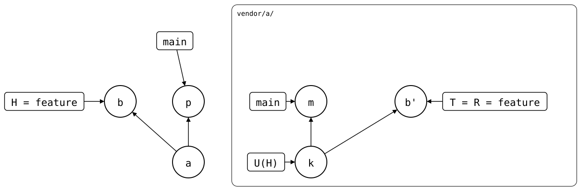

# Rebasing a feature branch

A feature branch was pushed, so upstream has it as a PR. Then upstream's
`main` moved on, and the monorepo's `main` pulled that in. The PR is now
behind `main`: GitHub says "This branch is out-of-date with the base
branch". To bring it up to date, `feature` is rebased onto `main`.
*m* adds `lock.txt`:

<div align="center">



</div>

## The rebase strategies

Four branches take part, two in each repository, and `git-splice`
syncs the monorepo's folder with the upstream branch of the same name.
Rebasing `feature` onto `main` is plain Git, and it's one operation
that can be done in either repository. Do it in one of them only, then
carry the result across with `git-splice`, in this order:

<div align="center">


</div>

1. **[Rebase via upstream](rebase-via-upstream.md)**: click "Update
   branch" on GitHub, or rebase `feature` onto `main` in a clone of the
   upstream, then `git splice pull` on `feature`. The simple default.
2. **[Rebase via monorepo](rebase-via-monorepo.md)**: `git rebase main`
   on `feature`, then `git splice push --force`. For when GitHub can't
   rebase, e.g. on a conflict, which you then resolve with the whole
   monorepo to build and test against. It rewrites the monorepo's
   `feature` and overwrites the PR, so it's for branches nobody else
   pushes to.

**[What you don't want](dont-pull-the-old-commits.md)**: mixing the
two. A rebase in the monorepo, then a pull of the PR that was never
rebased, sends the old commits back to the PR.

## Output

<!--
```scrut {fail_fast: true, output_stream: combined}
$ source "$TESTDIR/../../scenarios/readme-setup.sh"
```
-->

[`setup.bash`](setup.bash) builds this state:

```scrut
$ build_scenario scenario_feature_branch_behind_default_branch
```

<!--
```scrut
$ check_drawing "$TESTDIR/feature-branch-behind-default-branch.drawio.svg" \
>   p=main m=refs/splices/a/heads/main
ok   feature-branch-behind-default-branch.drawio.svg: 6 commits, 9 arrows, 5 boxes, 1 lanes
```
-->

```scrut
$ git -C "$UPSTREAM" log --graph --format=%s main feature
* m: bump dep
| * b: feature change
|/  
* k: seed
```

`git-splice` compares `feature` with upstream's `feature` only, and
those match. That the PR is behind `main` is a matter between the two
branches of each repository:

```scrut
$ git splice status
On branch feature

  up to date  vendor/a
```
