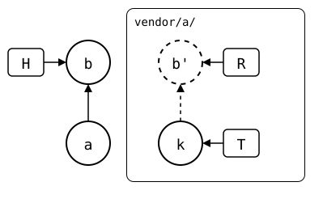
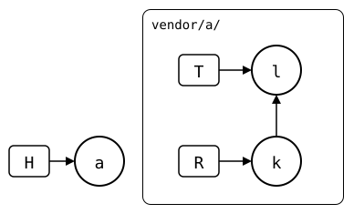
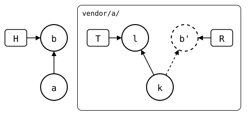
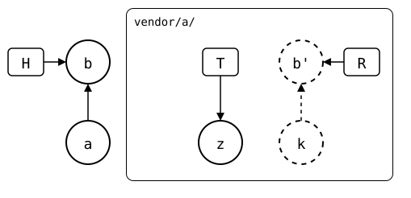

# status

`git splice status [--upstream <name>] [path…]`

Lists every splice: a folder with a
[`.splice` file](../concepts/splice-file/README.md). Each one gets its sync
state, with commits counted like `git status` counts them against a
tracking branch: "behind 1" is one commit for `pull` to bring in.
`status` doesn't fetch; it uses what was fetched last.

<!-- Builds a fresh sandbox; see `just docs-check`.
```scrut {fail_fast: true, output_stream: combined}
$ source "$TESTDIR/scrut-setup.sh"
```
-->

In the [walkthrough's repositories](README.md), `vendor/pkg-a/`'s upstream has one commit the
monorepo doesn't have yet:

```scrut
$ git splice status
On branch main

  behind 1  vendor/pkg-a
```

## Sync states

`status` reports one of these states for each splice, and `merge`, `pull`
and `push` act on it. Each example is a small, tested scenario;
[all scenarios](../scenarios/README.md) cover more situations.
`status` lists the splices that need something first, most urgent first,
as in [this monorepo with many splices](../scenarios/01-everyday-sync/03-many-splices/README.md).
In the drawings, H is `HEAD`, R the rebuild `push` would send, and T
the fetched upstream branch; dashed commits are on no upstream branch
yet ([sync model](../concepts/sync-model/README.md)).

| `status` shows | Meaning | What to do |
| --- | --- | --- |
| `?? never fetched` | The upstream wasn't fetched in this clone yet. ([example](../scenarios/01-everyday-sync/04-never-fetched/README.md)) | Run `git splice fetch`. |
| `?? synced commit X isn't here` | `.splice` names an upstream commit this clone doesn't have, e.g. after `git pull` brought in a teammate's `git splice pull`. ([example](../scenarios/03-branches-and-teamwork/06-teammate-pulled/README.md)) | Run `git splice fetch`. If upstream doesn't have the commit any more, `pull` and `push` print the ways to pick a side. |
| `up to date` | Both sides are the same. ([example](../scenarios/01-everyday-sync/02-up-to-date/README.md))<br/> | Nothing to do. |
| `ahead N` | Only your side changed. ([example](../scenarios/01-everyday-sync/02-up-to-date/02-push-ahead/README.md))<br/> | Run `git splice push`. |
| `behind N` | Only the upstream changed. ([example](../scenarios/01-everyday-sync/02-up-to-date/01-pull-ahead/README.md))<br/> | Run `git splice pull`. |
| `ahead N, behind M` | Both sides changed since they last matched. ([example](../scenarios/01-everyday-sync/02-up-to-date/02-push-ahead/03-diverged-common-ancestor/README.md))<br/> | Run `git splice pull`, then `push`. On a conflict, resolve it and `git commit` first. |
| `!! unrelated history` | Both sides changed and share no history, e.g. the upstream was rebuilt from scratch. ([example](../scenarios/06-rewritten-history/03-diverged-unrelated-history/README.md))<br/> | Pick a side. `merge`, `pull` and `push` refuse to guess and print the commands to keep either side, or both. |
| `unchanged, no upstream branch` or `new, ahead N` | The upstream has no branch with your branch's name. Compared with upstream's default branch, as for a PR: it has every commit of the splice already, or lacks N of them -- also ones from the branch yours was cut from. ([unchanged](../scenarios/03-branches-and-teamwork/01-feature-branch-unchanged/README.md), [changed](../scenarios/03-branches-and-teamwork/01-feature-branch-unchanged/01-feature-branch-changed/README.md), [from `main`](../scenarios/03-branches-and-teamwork/02-feature-branch-from-main/README.md), [stacked](../scenarios/03-branches-and-teamwork/01-feature-branch-unchanged/01-feature-branch-changed/01-stacked-branch/README.md)) | Run `git splice push`. It creates the branch only if the default branch lacks commits. |

What `status` compares to tell the states apart: the
[sync model](../concepts/sync-model/README.md).
